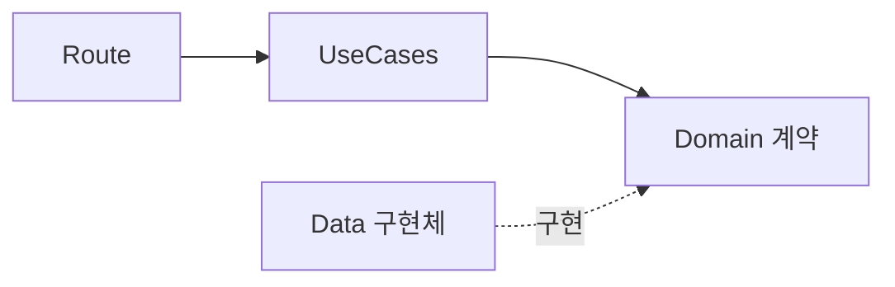

처음에는 auth, db, storage, system처럼 기능별로 모듈을 나눴다. 각 기능이 Route, Service, Repository와 구현체를 한곳에 가지고 있으니, 처음 기능을 만들 때는 따라가기 편했다.

하지만 auth를 만들면서, authService에서 DB기능을 사용하니까 이 구분이 조금 어색해졌다. 처음에는 '가벼우니까' 라고 그냥 뒀는데, 에러가 계층을 뚫고 코드 내부를 막 횡단하는 것을 보고 구조를 한번 정리해야겠다고 생각했다.

이 김에 네이밍 규칙도 바꿨다. 기존의 Service 라고 이름 붙은 파일들을 UseCases로 변경했다. Store 파일들은 Repository라고 명시적으로 붙일까 생각했는데, 이건 딱히 오해를 불러일으킬 것 같진 않아서 당장은 그대로 냅뒀다.

## 기존 구조

원래 구조에서는 auth, db, stroage, system 디렉토리 내부에 모든 계층이 같이 들어있었다.

DB Service는 DB Repository에만 의존하는 사실상 구현체를 래핑하는 상태였다. Mock 서버인지라, 기능이 단순해서 하나의 유즈케이스가 여러 기능을 합쳐서 사용할 일이 별로 없었기 때문이다.



하지만 auth를 생각해보면 사용자의 정보를 어딘가에는 저장해야 하고, DB 기능을 써야 해서, DB 기능을 가져오는 코드를 사용했다. 마찬가지로 만약 DB 접근에 인증이 요구된다면 auth 기능을 써야하지 않을까? 라는 생각을 했다.

결국 현재 디렉토리 구조는 프로젝트 구조를 정확하게 드러내지 못한다 생각해서 디렉토리 구조를 한번 갈아 엎었다.

## 계층 기준으로 다시 나누기

그래서 기능별로 파일을 모으는 대신, 코드가 맡은 책임을 기준으로 디렉터리를 나눴다.



의존관계의 입장에서 봤을 때, 구조는 이전과 크게 달라지지 않았다. 디렉토리를 정리했고, system 쪽만 구조에 맞게 계층을 좀 나눴다.



Route는 UseCase를 호출하고, UseCase는 Domain의 계약에 의존한다. JSON 파일이나 메모리 저장소 같은 실제 구현체는 그 계약을 구현할 뿐이다. 따라서 UseCase와 Route는 어떤 구현체가 선택됐는지 알 필요가 없다.

## API는 HTTP만 알기

`api`에는 Express와 HTTP 요청에 직접 관련된 코드만 둔다. 처음에는 `presentation`으로 할 까 생각도 했는데, 너무 iOS 느낌도 나고(나쁜건 아니지만), 실제로 뭔가를 보여주는 계층은 아니기 때문에 `api`로 이름을 정했다.

```text
api/
├─ routes/
└─ middleware/
```

`api`에는 라우트와 미들웨어가 들어간다. 라우트는 요청과 파라미터를 읽고, UseCase를 호출한 뒤, 결과를 HTTP 응답으로 변환한다. 

CORS 같은 Express 미들웨어도 이 계층에 둔다. 파일을 실제로 읽고 쓰거나, 인증과 DB의 규칙을 판단하는 일은 Route의 책임이 아니다. 

Multer는 Storage의 라우트 동작에만 연관된 미들웨어이기 때문에 이 디렉토리에 두지 않았다.

## Application은 유즈케이스를 제공하기

기존 `Service`는 `UseCases`로 이름을 바꿨다.

```text
application/
├─ authUseCases.ts
├─ databaseUseCases.ts
├─ storageUseCases.ts
└─ systemUseCases.ts
```

Application은 `RecordStore`, `TokenStore`, `FileStorage`처럼 Domain에 정의된 인터페이스만 사용한다. 예를 들어 AuthUseCases는 인증 저장소뿐 아니라 DB를 사용해 사용자를 조회할 수 있다. 

Repository 에러를 Application 에러로 변환하는 구조는 [다음 개발일지]()에서 이어서 정리했다.

## Domain과 Data 분리하기

`domain`에는 구현과 독립적인 계약을 둔다.

```text
domain/
├─ auth/
├─ db/
├─ storage/
└─ system/
```

반면 실제 구현체는 `data`에 둔다.

```text
data/
├─ auth/ 
├─ db/
├─ storage/
└─ persistence/
```

보면 Repository 패턴과 사실상 같은 계층이다. `jsonFile.ts`처럼 파일 시스템을 직접 다루는 유틸리티도 저장 방식의 일부이므로 `data/persistence`에 배치했다. 

애플리케이션은 JSON 파일을 직접 알지 않고, `FileStorage`나 `RecordStore`라는 계약만 본다. 

## System과 테스트도 같은 기준으로

구조가 가장 간단했던 System도 다른 기능과 같은 흐름으로 맞췄다.

```text
System Route
    ↓
SystemUseCases
    ↓
SystemRepository
```

현재 SystemRepository는 서버 시작 시각을 보관하고 uptime을 계산할 뿐 다른 의존성을 사용하지 않고, 확장할 계획도 지금은 없다. 그래서 딱히 시스템의 Domain 계층을 추상화할 필요를 느끼지 못했고, 구현체에 유즈케이스가 직접 의존한다.

## 테스트

테스트도 소스와 같은 기준으로 재배치했다.

```text
tests/
├─ unit/
│  ├─ application/
│  ├─ api/
│  ├─ config/
│  └─ data/
└─ integration/
```

`application`은 유즈케이스 흐름을, `data`는 저장소 구현체를, `api`는 Express에 특화된 미들웨어를 검증한다. `integration`은 Supertest로 실제 HTTP 요청부터 응답까지의 계약을 확인한다.

## 정리

기존 구조는 역할 기반 분리와 계층 기반 분리가 섞여있었다. 유즈케이스 중에서 DB 관련 유즈케이스는 분명히 DB Repository를 많이 사용한다. 하지만 그렇다고 해서 DB 유즈케이스와 DB Repository가 같은 디렉토리에 묶일 이유는 없고, 오히려 구조가 난잡해진다.

예를 들어서, 특정 DB를 조회해서 데이터를 꺼내오는 유즈케이스를 생각해보면, 이 서버는 Mock 서버라서 인증을 거치지 않는데, 만약 프로덕션 서버라면 인증을 거쳐야 하는 작업이다. 즉, 유즈케이스와 Repository가 1:1로 대응이 되지 않는다. 이 서버에서도 auth는 유즈케이스는 DB Repository를 이용해야 했다.

하지만 의존성 측면에 있어서 기존 구조가 나쁘지 않은 구조라서, 파일의 디렉토리만 정리했고, 크게 바꿀 부분은 없었다. 여전히 라우트는 유즈케이스를, 유즈케이스는 레포지토리를 호출하고, 레포지토리는 구현체를 쉽게 갈아끼울 수 있다.

구조를 정리한 이유는 에러를 구조화하기 위해서 정리했다. 의존성 방향은 분명한데, 에러는 그 의존성 경계를 뚫고 지나가버린다. 다음 개발 일지에서는 에러를 구조화한 것에 대해서 작성한다.
