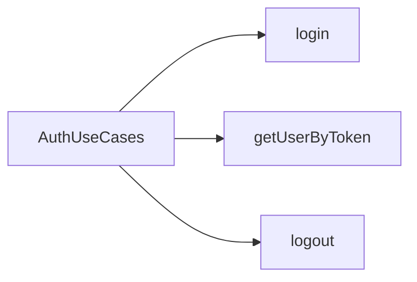
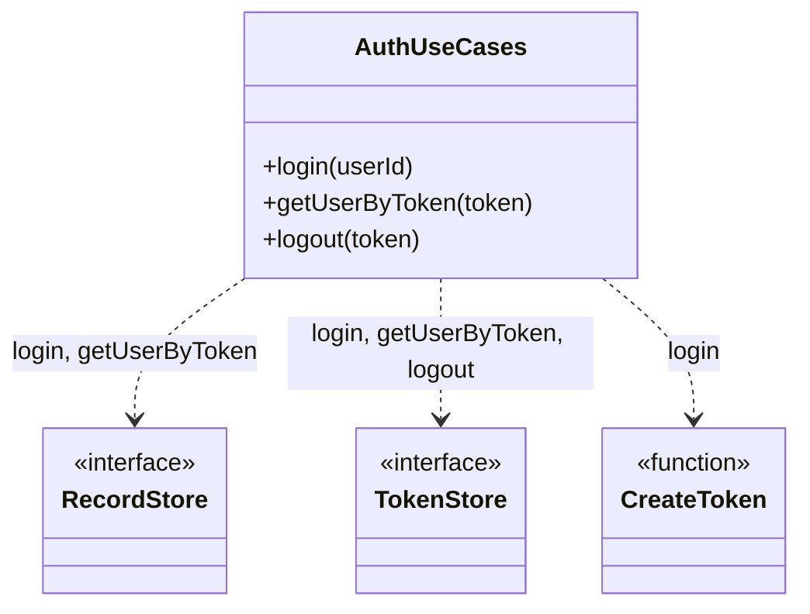
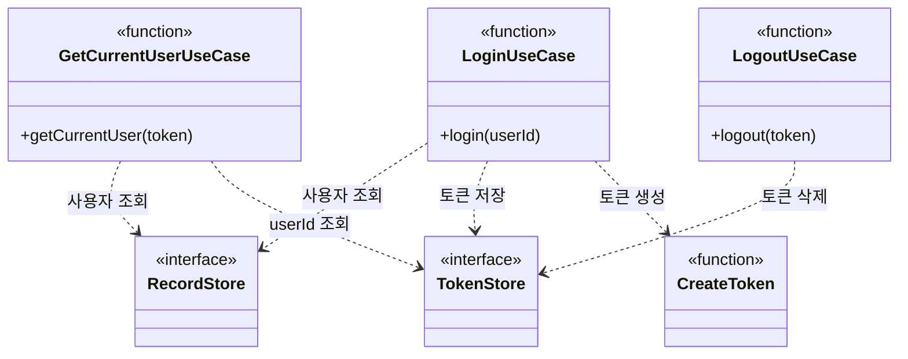
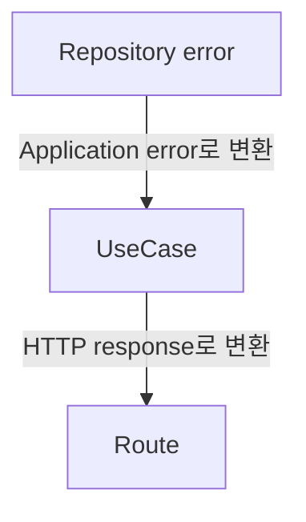

기존 코드에서는 유즈케이스들이 `StorageUseCases`, `SystemUseCases` 같은 기능 단위로 하나의 클래스에 메소드 형태로 묶여있었다.

처음에는 기능별로 관련된 동작이 모여 있으니 자연스러웠는데, 실제로는 각각의 유즈케이스들이 서로 다른 의존성을 사용한다.

이미 프로토타입인 dev-data-server를 할 때도 '클라이언트에서 요청하는 DB 기능'과 '실제 DB 구현체 기능'이 서로 다른 레이어인 것은 인지하고 있었다. 하지만 두 기능이 1:1 대응해서 매핑만 해야 한다고 착각을 하고 있었다.



DB 동작에서 '접근할 수 있는 데이터인가?'를 인증하기 위해 Auth 기능이 필요할 수 있다. 반대로 Auth 기능에서 유저의 정보를 저장하기 위해서 DB 동작이 필요할 수도 있다. Storage도 파일의 메타 데이터를 저장하기 위해 DB 기능이 필요할 수도 있다.

기존 구조에서는 1:1 매핑을 전제로 만들어져 있어서 유즈케이스들이 기능 단위로 묶여있다. 

사실 동작 자체는 큰 문제가 없다. 하지만 이번 포스팅에서 각 유즈케이스들을 클래스에서 분리시키려고 하는데, 그 이유는 다음과 같다:

1. 여러 유즈케이스가 하나의 클래스로 묶여있어서 단 하나의 유즈케이스만 사용하는 의존성을 위해서 다른 서비스(혹은 레포지토리) 의존성이 클래스 전체에 추가된다.
2. Storage 라우터에서 DB 유즈케이스 하나를 사용해야 한다고 가정했을 때, DB 유즈케이스 클래스 내부에 있는 모든 메소드(유즈케이스)를 꼭 알아야 하는가?

## 기존 구조

기존 Application 레이어는 유즈케이스들을 기능 단위로 묶은 여러 클래스로 관리되고 있었다:

```text
application/
├─ authUseCases.ts
├─ databaseUseCases.ts
├─ storageUseCases.ts
└─ systemUseCases.ts
```

예를 들어, `DatabaseUseCases` 클래스는 사용자가 서버의 DB에 접근하는 모든 유즈케이스들을 메소드로 가지고 있다:

```ts
export class DatabaseUseCases {
  constructor(private readonly recordStore: RecordStore) {}

  async listRecords(collection: string) {}
  async getRecord(collection: string, id: string) {}
  async createRecord(collection: string, data: RecordData) {}
  async replaceRecord(
    collection: string,
    id: string,
    data: RecordData,
  ) {}
  async deleteRecord(collection: string, id: string) {}
}
```

Route는 이 유즈케이스 묶음 클래스 전체를 전달받은 다음, 들어온 API 요청에 맞게 사용했다.

```ts
const databaseUseCases = new DatabaseUseCases(recordStore);

app.use(
  "/collections",
  createCollectionsRouter(databaseUseCases),
);
```

이 구조가 틀린 것은 아니다. 컬렉션 Route는 CRUD 메소드를 모두 사용하고, 현재 규모에서는 클래스 하나로 묶어 두는 편이 읽기 쉬울 수도 있다.

다만 Auth를 보면 각 동작이 필요한 의존성이 다르다는 점이 더 분명해진다.



기존 AuthUseCases는 위 의존성을 생성자에서 모두 받았다. 로그아웃만 생각하면 TokenStore만 있으면 되는데도, 로그인에 필요한 RecordStore와 token 생성기까지 한 객체에 묶여 있었다.

## 유즈케이스를 독립시키자

이번에는 기능이 아니라 애플리케이션이 수행하는 동작을 기준으로 파일을 나눴다.

```text
application/
├─ database/
│  ├─ createRecordUseCase.ts
│  ├─ deleteRecordUseCase.ts
│  ├─ getRecordUseCase.ts
│  ├─ listRecordsUseCase.ts
│  └─ replaceRecordUseCase.ts
├─ auth/
│  ├─ getCurrentUserUseCase.ts
│  ├─ loginUseCase.ts
│  └─ logoutUseCase.ts
├─ storage/
└─ system/
```

각 파일은 하나의 동작과 그 동작에 필요한 의존성만 표현한다.

```ts
export type LogoutUseCase = (token: string) => Promise<void>;

export function createLogoutUseCase({
  tokenStore,
}: {
  tokenStore: TokenStore;
}): LogoutUseCase {
  return async (token) => {
    try {
      await tokenStore.delete(token);
    } catch (error) {
      throw mapTokenStoreError(error);
    }
  };
}
```

예를 들어서, 기존에 `AuthUseCases`에 있던 `LogoutUseCase` 메소드에는 `TokenStore`만 전달한다. 이전처럼 `RecordStore`를 알지 않아도 된다.

```ts
const logout = createLogoutUseCase({ tokenStore });
```

반면 `LoginUseCase`는 사용자 조회와 토큰 저장, 토큰 생성을 모두 필요로 한다. 이 유즈케이스 때문에, Auth 관련 유즈케이스 모두가 `RecordStore`를 알게 되었는데, 이제 얘만 알게 관심사를 분리할 수 있다.

```ts
const login = createLoginUseCase({
  recordStore,
  tokenStore,
  createToken: randomUUID,
});
```

클래스의 생성자와 메소드 조합을, 의존성을 받는 팩토리 함수와 실행 함수로 바꿨다. (뭔가 클래스 다이어그램 보니 더 더러워진것 같다...)



유즈케이스 자체에 상태가 없기 때문에 클래스를 유지할 이유가 크지 않다. 만약 필요하다면? 그 유즈케이스만 클래스로 만들면 된다.

## ISP 관점에서 생각해보기

ISP는 클라이언트가 사용하지 않는 기능에 의존하도록 강제하지 말라는 원칙이다. (당연하지만)여기서 인터페이스는 `interface` 선언만이 아니라, 클래스 생성자나 함수가 요구하는 의존성의 묶음까지 넓게 볼 수 있다.

기존 `AuthUseCases`는 로그인, 현재 사용자 조회, 로그아웃을 한 클래스에 넣고 필요한 의존성을 생성자에서 모두 받았다.

```ts
const authUseCases = new AuthUseCases(
  recordStore,
  tokenStore,
  randomUUID,
);
```

하지만 각 동작이 실제로 쓰는 의존성은 같지 않다. 로그아웃은 `TokenStore`만 필요하고, 로그인만 `RecordStore`와 token 생성기를 함께 사용한다.

이번 리팩터링에서는 동작별 유즈케이스 팩토리가 필요한 의존성만 받도록 바뀌었다.

```ts
const logout = createLogoutUseCase({ tokenStore });

const login = createLoginUseCase({
  recordStore,
  tokenStore,
  createToken: randomUUID,
});
```

이 구조에서는 로그아웃 코드가 `RecordStore`나 token 생성기를 알 필요가 없다. 각 유즈케이스의 이니셜라이저가 요구하는 의존성을 명확하게 드러내므로, 의존성도 더 쉽게 확인할 수 있다.

솔직히 MVVM에서 Input Output 프로토콜을 나누는 것 처럼 여러 개의 인터페이스로 나눈 전형적인 ISP 위반 해결 사례는 아니지만... 핵심은 동작별로 의존성을 분리한 것이다.

다만 그 결과로 각 유즈케이스가 사용하지 않는 의존성을 모르게되므로, ISP의 방향과는 잘 맞는다고 생각한다.

Route도 마찬가지로 큰 유즈케이스 묶음 클래스 대신 대신 필요한 유즈케이스 함수들을 전달받는다:

```ts
createCollectionsRouter({
  listRecords,
  getRecord,
  createRecord,
  replaceRecord,
  deleteRecord,
});
```

### Trade-off

묶어져 있는 유즈케이스를 분리하면서 앱 조립부인 `app.ts`는 길어지게 된다:

```ts
const listRecords = createListRecordsUseCase({ recordStore });
const getRecord = createGetRecordUseCase({ recordStore });
const createRecord = createCreateRecordUseCase({ recordStore });
const replaceRecord = createReplaceRecordUseCase({ recordStore });
const deleteRecord = createDeleteRecordUseCase({ recordStore });
```

대신 어떤 유즈케이스가 어떤 의존성을 사용하는지 한 곳에서 확인할 수 있다.

## 에러 경계와 HTTP 계약

유즈케이스를 나눴다고 해서 [이전 포스팅]()에서 정리한 에러 경계가 바뀌면 안 된다. 

각각의 유즈케이스는 Store 에러를 Application 에러로 변환하고, Route는 Application 에러를 HTTP 응답으로 바꾼다.



외부 API도 그대로 유지했다. 내부에서는 UseCase 클래스가 사라졌지만, 컬렉션 CRUD, 로그인, 현재 사용자 조회, 로그아웃, 파일 API의 경로와 응답 형식은 바꾸지 않았다.

## 테스트도 동작 단위로 나누기

소스가 동작 단위로 나뉘었으므로 단위 테스트도 같은 기준으로 옮겼다.

```text
tests/unit/application/
├─ database/
│  ├─ createRecordUseCase.test.ts
│  ├─ deleteRecordUseCase.test.ts
│  ├─ getRecordUseCase.test.ts
│  ├─ listRecordsUseCase.test.ts
│  └─ replaceRecordUseCase.test.ts
├─ auth/
│  ├─ getCurrentUserUseCase.test.ts
│  ├─ loginUseCase.test.ts
│  └─ logoutUseCase.test.ts
├─ storage/
└─ system/
```

예를 들어 로그아웃 테스트는 토큰 삭제와 TokenStore 에러 변환만 확인하면 된다. 로그인에 필요한 사용자 저장소나 token 생성기를 함께 준비할 필요가 없다.

HTTP 계약 테스트는 그대로 유지해서, 내부 리팩터링이 클라이언트의 동작을 바꾸지 않았는지도 확인했다.

## 정리

이번 작업에서는 기능별로 묶여 있던 유즈케이스를 동작별 함수로 분리했다. 처음에는 하나의 기능에 속한 동작을 하나의 객체로 묶는 것이 자연스럽다고 생각했다. 

(이전 포스팅들을 포함해서 한 3번정도 반복하는 것 같지만) 동작마다 사용하는 의존성과 에러 변환, 테스트 범위가 다르다. 

DevBox는 BaaS와 유사한 기능을 제공하는 Mock 서버이므로, 유즈케이스도 'DB'라는 용어를 사용해서 착시를 일으킨다. 

다만 기능이라는 이름만 같을 뿐, 애플리케이션에서 수행하는 책임은 서로 독립적이다. 모든 레이어가 상위/하위 레이어와 1:1 매핑되는건 아니다.

그래서 `DatabaseUseCases`를 `CreateRecordUseCase`, `GetRecordUseCase`, `ListRecordsUseCase`처럼 나누고, Auth와 Storage도 같은 기준으로 분리했다. 

클래스 대신 의존성을 받는 팩토리 함수와 실행 함수를 사용했고, 모든 조립은 `app.ts`에서 담당하도록 했다. 코드 양은 조금 늘었지만 각 유즈케이스의 책임과 의존성을 더 명확하게 만들 수 있다.
