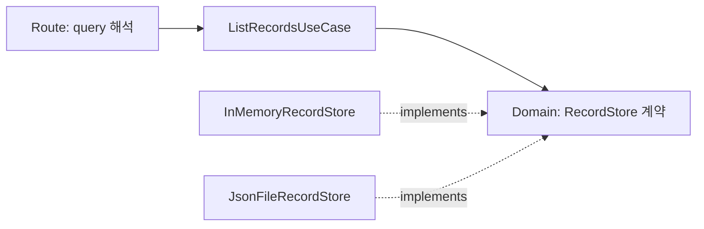

컬렉션 전체를 조회하는 API는 존재하지만, 컬렉션 내부에서 원하는 레코드만 보려면, 클라이언트에서 따로 처리를 해야했다.

앱을 붙여 보려면 이제 상태가 open인 할 일만 가져오거나, 완료되지 않은 항목만 가져와야 했다. 즉, 다음과 같은 API가 필요했다:

```http
GET /collections/todos?filter[status]=open&filter[completed]=false
```

이번 포스팅에서는 필터링 기능을 추가하면 어떤 고민을 했고, 어떻게 해결했는지에 대해 정리한다.

## Filter는 어떤 레이어에 있어야 할까

가장 간단한 방법은 유즈케이스가 모든 레코드를 가져온 뒤, 유즈케이스 내부에서 필터링 하는 것이다.

```ts
const records = await recordStore.list(collection);

return records.filter((record) =>
  record.data.status === "open",
);
```

클라이언트에서는 필터링 기능이 어떻게 동작하는지 모르기 때문에 클라이언트 관점에서는 문제가 없다.

그래서 유즈케이스에 있어도 되나? 처럼 고민하고 있었는데, 사용하고 있지도 않은 SQL이 힌트를 줬다. 

```text
만약 유즈케이스에서 필터링 한다면 SQL `WHERE`를 쓸 수 없다.
```

필터링은 목록 조회 과정의 일부지, 특정 유즈케이스에만 속한 정책은 아니다. 그래서 필터링 기능은 `RecordStore`에 포함시키는 편이 맞다고 판단했다.

### List에 filter를 추가하기

필터링 기능은 `RecordStore`에 포함시키기로 결정했지만, 어떻게 포함시켜야 하는지 고민을 했다. 처음에는 '컬렉션의 전체 데이터 불러오기'와 '컬렉션에서 필터링된 데이터 불러오기'를 서로 따로 생각했다.

```ts
listRecords(collection)
filterRecords(collection, filter)
```

`Store` 내부에서 당연히 메소드를 따로 만들기로 생각하고 있을 때 든 고민은 다음과 같다.

1. 유즈케이스(`getRecordUseCase`)이름을 똑같이 하고, `filter`의 유무로 오버로딩을 하는게 좋을까?
2. 아니면 유즈케이스를 처음부터 둘로 나눌까? (`getRecordUseCase`, `getFilteredRecordUseCase`)

하지만 고민하다 내린 결론은 둘 다 아니었고, 그냥 '필터 없는 조회가 필요 없다'이다. 

물론 기능을 없앤다는게 아니라, 그냥 '필터 없는 조회'는 조건이 비어 있는 '필터 조회'이다. 필터가 없는 조회는 조건이 비어 있는 필터 조회로 볼 수도 있다.

그래서 목록 조회에 옵션을 추가했다:

```ts
export type FilterValue = string | number | boolean | null;
export type RecordFilter = Record<string, FilterValue>;
export type ListRecordsOptions = {
  filter?: RecordFilter;
};
```

`RecordStore`도 같은 옵션을 받도록 확장했다.

```ts
export interface RecordStore {
  list(
    collection: string,
    options?: ListRecordsOptions,
  ): Promise<StoredRecord[]>;
}
```

현재 구현은 필터가 없는 전체 조회를 그대로 유지하기 위해 `options` 자체를 옵셔널로 뒀다.

```ts
await recordStore.list("todos");

await recordStore.list("todos", {
  filter: { status: "open" },
});
```

필터가 없는 목록 조회는 `options`를 생략하고, 필터가 있는 경우에만 filter 객체를 전달한다. 

구현체 내부에서는 `Object.entries(filter)`로 조건들을 순회하며, 모든 조건이 일치하는 레코드만 반환한다. 현재는 완전 일치 조건만 필요하므로, 연산자까지 표현하는 별도 쿼리 모델은 만들지 않았다.

## Filter 타입은 Domain에 둔다

필터는 `RecordStore` 인터페이스의 두 구현체에서 실행되기 때문에 `src/data/db`에 타입이나 공통 코드를 두는 것이 맞지 않나 생각했다.

하지만 `/data`는 JSON 파일이나 Map처럼 구체적인 저장 방식을 아는 곳이다. 반면 필터 기능 자체는 `RecordStore`가 어떤 조건으로 목록을 조회할 수 있는지는 저장 방식과 관계없이 지켜야 한다.



그래서 `FilterValue`, `RecordFilter`, `ListRecordsOptions`는 `domain/db`에 두고, 각 구현체가 각자의 방식으로 구현하도록 했다.

이 때, 유즈케이스는 필터를 직접 해석하거나 적용하지 않는다. 옵션을 레포지토리에 전달하고, 이전과 같이 레포지토리 에러를 Application 에러로 매핑한다.

```ts
export function createListRecordsUseCase({
  recordStore,
}: {
  recordStore: RecordStore;
}): ListRecordsUseCase {
  return async (collection, options) => {
    try {
      return await recordStore.list(collection, options);
    } catch (error) {
      throw mapRecordStoreError(error);
    }
  };
}
```

이렇게 해두면 JSON 구현체는 파일을 읽은 뒤 메모리에서 비교하고, SQL 구현체는 `WHERE`를 사용하더라도 유즈케이스는 달라질 필요가 없다.

### filter를 재사용 해야할까

in-memory와 JSON 구현체는 현재 같은 비교 규칙을 각각 가지고 있다. 

```ts
return records.filter((record) =>
  Object.entries(filter).every(([field, value]) =>
    (field === "id" ? record.id : record.data[field]) === value,
  ),
);
```

중복처럼 보이기 때문에 `filter.ts` 같은 공통 함수를 만들고 싶었다.하지만 공통 함수는 단순히 중복을 줄이는 대신 새로운 추상화와 이름을 추가한다. 

현재는 구현체가 JSON과 in-memory 방식 두 가지 밖에 없지만, SQL 구현체를 나중에 추가한다면? SQL은 같은 결과를 내더라도 이 로직이 아니라 `WHERE`를 사용하게 된다.

따라서 전형적인 '가짜 추상화'가 될 가능성이 높다고 판단했다. 이번에는 필터링의 동작만 도메인에서 맞추고, 구체적인 코드는 각 구현체의 list 내부에서 따로 구현하도록 남겨뒀다.

구현 방식이 정말 여러 곳에서 복잡하게 겹칠 때 공통화를 고민하는 편이 낫다고 생각했다.

## Route는 쿼리 해석만

HTTP query string은 모두 스트링으로 들어온다.

```text
filter[completed]=false
filter[priority]=3
```

저장된 값이 boolean `false`나 number `3`이라면 스트링 그대로 비교할 수 없다. 따라서 Route에서 스트링을 Domain이 허용하는 값으로 바꾼다.

```ts
function parseFilterValue(value: string): FilterValue {
  if (value === "true") return true;
  if (value === "false") return false;
  if (value === "null") return null;

  const numericValue = Number(value);
  if (value.trim() !== "" && Number.isFinite(numericValue)) {
    return numericValue;
  }
  return value;
}
```

Route는 HTTP 형식을 해석하고, 유즈케이스와 레포지토리는 이미 타입이 정리된 `RecordFilter`만 받는다. 이 경계 덕분에 레포지토리가 Express의 쿼리 객체를 알 필요는 없다.

만약 잘못된 형태의 필터가 들어온 경우에는 빈 결과로 처리하지 않고 400 응답을 반환한다.

```http
GET /collections/todos?filter[]=open
```

```json
{ "error": "invalid_filter" }
```

## 이번 filter의 범위

이번에는 다음만 지원한다.

- 최상위 필드의 완전 일치
- string, number, boolean, null
- 여러 조건의 AND
- 레코드 id 조회

예를 들어 다음 요청은 status가 open이고 completed가 false인 레코드만 반환한다.

```http
GET /collections/todos?filter[status]=open&filter[completed]=false
```

중첩 필드, 부분 일치, 비교 연산자, OR 조건, 정렬과 페이지네이션은 아직 지원하지 않는다. 이런 기능을 넣으려면 단순한 RecordFilter보다 더 큰 쿼리 표현식을 설계해야 한다.

Mock 서버에 필요한 수준을 넘어서기 시작하면, 그때 실제 사용 사례를 기준으로 확장하는 편이 낫다.

## 정리

MVP 이후 코드를 다듬거나, 아키텍처를 정리하는 방향을 했는데, 처음으로 서버의 기능을 추가했다.

물론 Supabase 수준의 필터 기능을 추가한건 아니다. Supabase API는 SQL이 거의 그대로 외부로 드러나는 수준인데, 아키텍처 측면에서 좋은 방향이라고 생각하진 않기 때문이다. 당연히 서비스 도메인에서 결정한 의도적 노출이지만...

필터링 기능을 추가하면서 가장 오래 고민한 것은 비교 코드를 어디에 둘지가 아니라, 조회 조건을 누가 책임져야 하는가였다.

유즈케이스가 모든 레코드를 가져와 필터링하면 지금은 편하지만, 저장소 구현체가 가진 조회 능력을 활용할 수 없다. 그래서 목록 조회 조건을 `RecordStore`의 도메인에 포함시켰다.

Route는 쿼리 스트링을 타입이 있는 필터 값으로 바꾸고, 유즈케이스는 그 옵션을 전달하며, 각 Store는 자신의 방식으로 조건을 실행한다. 

이 구조라면 지금은 JSON과 In-Memory에서 같은 동작을 보장하고, 나중에는 (도입한다면)SQL의 WHERE 절을 사용할 수 있다.

별개로, 이번 작업에서 꽤 많은 고민을 했고, 해결 방법이 생각보다 명확하고 깔끔해서 마음에 들었다.



추상화는 일단 만들고 시작한 것이 아니라, 필요한 계약만 먼저 만들었다. 필터 구현의 중복이 실제 문제가 되는 시점에만 재사용을 고민하려 한다.
