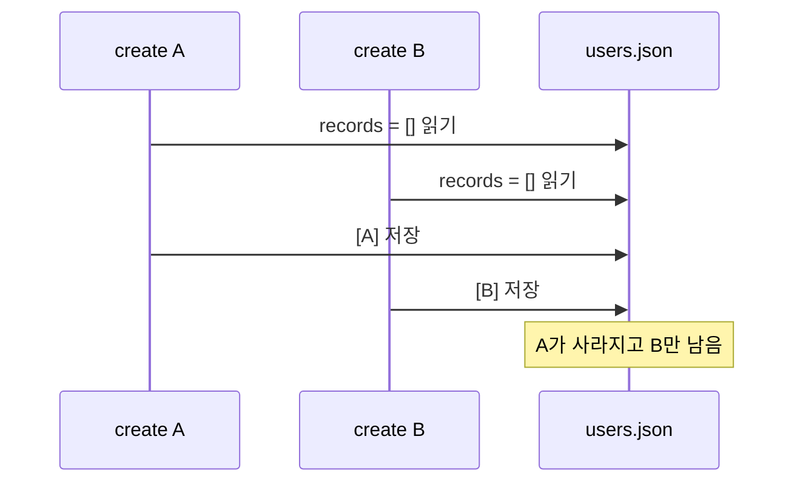

현재 사용중인 JSON 기반 DB 구현체는 JSON 파일 읽고, 새로운 임시 파일에 변경 사항을 쓰고, 그 임시 파일을 기존 파일과 교체하는 방식으로 동작한다. 작업 중일 때, 파일이 깨지는 문제는 해결하지만, 데이터 일관성 문제가 생길 수 있다. 

전형적인 데이터 레이스 문제이므로, Swift에서 자주 써서 익숙한 태스크 큐를 이용해서 파일 수정 태스크를 직렬화 하려 한다.

## 원자성으로는 막지 못하는 것

현재 `writeJsonFile`은 다음 순서로 파일을 저장한다:


OS가 같은 파일 시스템 안에서 `rename`을 원자적으로 처리하기 때문에, 프로세스가 쓰기 도중 종료되더라도 `data.json`이 중간에 작성되다 만 것 같은 상태로 변경되는 것을 막는다.

그런데 `create` 요청 두 개가 거의 동시에 들어온다면 이야기가 달라진다. 두 태스크 모두 같은 파일의 이전 상태를 읽은 뒤, 각각의 변경 결과를 저장할 수 있다.



각 쓰기 자체는 원자적으로 끝났지만, 두 번째 태스크가 첫 번째 태스크의 결과를 모르는 상태에서 파일을 교체한다. 즉, 파일 손상은 없지만 데이터가 덮어씌워질 수 있다.

`JsonFileRecordStore`에서만 발생하는 문제도 아니라 토큰 저장할 때 쓰는 `JsonFileTokenStore`도 같은 입출력 방식을 사용하므로, 서로 다른 태스크가 동시에 같은 파일을 사용하면 문제가 된다.

## 태스크 큐

어떻게 해결해야 할까? 전형적인 데이터 레이스 문제이므로. Swift에서 사용한 액터의 컨셉을 가져와서 해결했다. 

서로 다른 파일간에는 동시성을 보장하고, 같은 파일을 수정하는 태스크는 직렬화할 수 있도록 태스크 큐를 만들었다:

```ts
const fileOperationQueues = new Map<string, Promise<void>>();

export async function runJsonFileOperation<T>(
  filePath: string,
  operation: () => Promise<T>,
): Promise<T> {
  const previous = fileOperationQueues.get(filePath) ?? Promise.resolve();
  let releaseCurrent!: () => void;
  const current = new Promise<void>((resolve) => {
    releaseCurrent = resolve;
  });
  fileOperationQueues.set(filePath, current);

  await previous;
  try {
    return await operation();
  } finally {
    releaseCurrent();
    if (fileOperationQueues.get(filePath) === current) {
      fileOperationQueues.delete(filePath);
    }
  }
}
```

AI 에이전트가 작성한 코드인데, `Promise`에 대한 이해도가 낮아서 코드를 분석하는게 좀 힘들었다. 덕분에 TS의 `Promise`, `async`/`await`, 함수 시그니처까지 다시 정리했다.

### Promise 체인과 태스크 직렬화

기본적인 컨셉은 파일마다 각각 태스크 큐를 가지는 것이다.

```ts
const fileOperationQueues = new Map<string, Promise<void>>();
```

`fileOperationQueues`는 큐 자체가 아니다. 명시적인 배열이나 큐 자료구조 대신, 파일별로 마지막 태스크가 끝나는 시점을 나타내는 tail만 보관한다.

```ts
const previous = fileOperationQueues.get(filePath) ?? Promise.resolve();
let releaseCurrent!: () => void;
const current = new Promise<void>((resolve) => {
  releaseCurrent = resolve;
});
fileOperationQueues.set(filePath, current);
```

새 태스크는 먼저 파일의 이전 태스크를 가져온다. 이전 태스크가 없다면 `Promise.resolve()`로 완료된 상태의 더미 Promise를 만든다.

`releaseCurrent`는 `current` Promise를 완료시키는 resolve 함수다. 호출했을 때, 다음 태스크가 기다리던 Promise가 `fulfilled` 상태가 된다. Swift로 따지면 continuation을 `resume` 시키는 것과 비슷하다.

Swift에서도 continuation을 저장해서 관리하듯이, 여기서도 Promise를 생성해 `current`에 저장하고, 이 `current`를 큐의 tail 값으로 넣는다. 여기까지가 현재 태스크를 큐에 등록하는 과정이다.

```ts
await previous;
try {
  return await operation();
} finally {
  releaseCurrent();
  if (fileOperationQueues.get(filePath) === current) {
    fileOperationQueues.delete(filePath);
  }
}
```

등록이 끝났으면, `previous` 태스크가 끝날 때 까지 기다린다. `previous` 태스크가 끝난걸 어떻게 아느냐? 앞서서 우리는 `current`를 만들었고 큐에 저장했다. 이전 태스크도 마찬가지로 큐에 등록된 태스크고, 태스크를 마치면 자신의 `releaseCurrent`를 호출한다. 

큐를 직접 만들지 않아도, JS 런타임은 Promise가 완료된 뒤 이어질 태스크를 microtask 큐에서 처리한다. 우리는 Promise 간의 의존 관계를 직접 연결하기만 하면 된다.

그 후에 `operation()`이 값을 리턴하거나 에러를 던지는 것과 관계 없이 `finally`에서 다음 태스크를 진행시킨다. 에러가 발생한 태스크 하나 때문에 이후의 쓰기 태스크가 영원히 대기하면 안 되기 때문이다.

이렇게 쓰고 보니 액터보다는 GCD에 더 가까운것 같다...

### 유니크한 임시 파일 이름

기존 임시 파일 경로는 항상 `<file>.tmp`였다. 태스크를 직렬화 시켰으니 현재 구조에서는 같은 프로세스 안의 쓰기가 이 경로를 동시에 사용하지 않는다. 

그래도 `writeJsonFile` 자체는 태스크 큐 밖에서 호출될 수 있고, 여러 프로세스가 같은 디렉터리를 사용할 수도 있기 때문에(별로 좋지 않은 상황이겠지만) 임시 파일 이름에 UUID를 넣었다:

```ts
const tempPath = `${filePath}.${randomUUID()}.tmp`;
```

## 적용

방금 만든 태스크 큐를 `runJsonFileOperation`으로 감싼다:

```ts
async create(collection: string, data: RecordData): Promise<StoredRecord> {
  const filePath = this.collectionFilePath(collection);

  return runJsonFileOperation(filePath, async () => {
    const store = await this.readCollection(collection);
    const id = randomUUID();
    const next = {
      records: { ...store.records, [id]: structuredClone(data) },
    };

    await this.writeCollection(collection, next);
    return { id, data: structuredClone(data) };
  });
}
```

`replace`, `delete`도 같은 방식으로 처리했다. 토큰 저장소의 `save`, `remove` 역시 토큰 파일을 읽고 쓰는 부분을 감쌌다.

하지만 `get`, `list`, `getUserId` 같이 읽기만 하는 메소드는 원자성이 이미 보장되기 때문에, 큐를 적용하지 않았다. 읽기 메소드까지 태스크 큐에 등록하면 태스크 큐에 등록되는 태스크들이 과도해질 것이라 예상했다.

## 정리

이번 포스트에서느 원자성만 보장하는 것으로 비동기 문제가 해결되지 않으므로, 직접 유사 태스크 큐를 구현해서 파일 수정 태스크를 직렬화했다.

처음에는 프로젝트 전반에서 쓸 수 있는 유사 액터를 만들까 싶었는데, 굳이 그렇게 할 필요는 없었다. 이 태스크 큐는 JSON 구현체에서만 필요하고, SQL이나 다른 저장 방식으로만 넘어가도. 사용할 필요가 없어지거나 혹은 다른 구현이 필요할 수도 있기 때문이다.

작성한 것과 별개로 에이전트가 작성한 코드를 이해하기 위해 TS 공부를 꽤 해야했는데, 이건 따로 정리할 필요가 있어보인다.

1. `Promise<T>`, async/await에 대한 이해 (Swift async/await랑 꽤 다르다.)
2. TS의 `async` 함수와 리턴 값의 타입 `Promise` 간의 상관관계
3. JS 런타임의 microtask 큐

심지어 Swift에서 가장 비슷한 패턴인 Continuation도 복습하면서, AI한테 문제 내달라 하고 Continuation 구현하면서 복습도 했다...


