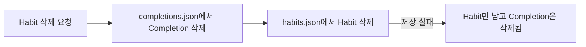
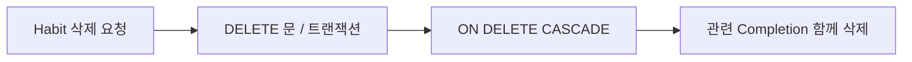
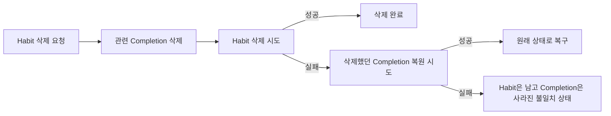
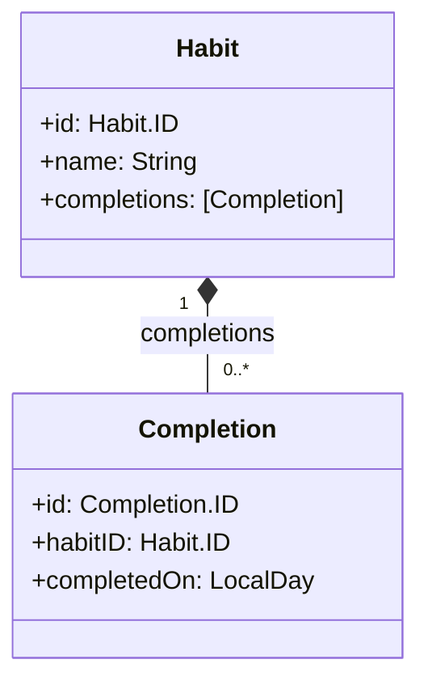
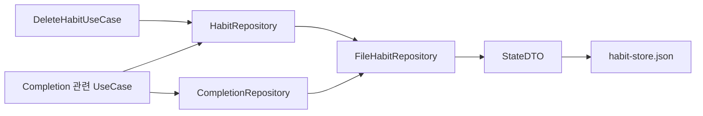

[JSON 영속성을 붙인 글]()에서 `Habit`과 `Completion`을 각각 다른 파일에 저장했다. 파일 하나를 안전하게 교체하는 방법은 마련했지만, 두 파일을 함께 바꾸는 작업의 원자성은 해결하지 못했다.

이 문제가 드러난 곳이 `DeleteHabitUseCase`다. `Habit`을 삭제하면 그에 속한 `Completion`도 함께 삭제해야 하는데, 당시 코드는 두 레포지토리를 순서대로 호출했다.

```swift
try await completionRepository.deleteAll(for: habitID)
try await habitRepository.delete(id: habitID)
```

`Completion` 삭제에 성공한 뒤 `Habit` 삭제가 실패하면, `Habit`만 남고 완료 기록은 사라진다. 각 파일을 임시 파일을 거쳐 교체해도 두 파일의 변경이 한 번에 성공하거나 실패하지는 않는다.



심지어 두 메소드 호출 사이에는 `await`도 있다. [Meet async/await in Swift]()에서 정리했듯, 중단된 사이 다른 태스크가 끼어들 수도 있다. (서로 다른 액터라서 방지도 못한다)

## 원자성 구현하기

`Habit`, `Completion`간 데이터 일관성을 지켜야 하는 것은 맞는데, 구조를 크게 변화시키고 싶진 않았다.

우선 `HabitRepository`와 `CompletionRepository`를 나눠진 상태는 유지하고 싶었다. `Completion`들만 따로 조회하는 경우가 있는데, `Habit` 내부에 `Completion` 배열을 넣게 된다면, 딱히 필요하지 않은 `Habit` 데이터도 불러와야 한다.

다음은 별도의 보일러 플레이트를 크게 늘리고 싶지 않았다... AI 에이전트가 가끔 별것 아닌데도 과도하게 패턴을 적용하는 경우가 있는데, 이건 피하고 싶었다.

### 앱 전체가 아니라 JSON 기반 영속성 구현체의 문제

조금 생각해보고, 우선 짚고 넘어간게, 이 문제 자체가 앱 전체의 문제는 당연히 아니다. `HabitRepository`와 `CompletionRepository` 두 레포지토리 프로토콜은 아무 잘못이 없다.

문제는 JSON 기반 영속성 구현체가 두 파일에 데이터를 각각 저장하면서, 그 두 파일간의 일관성을 지키지 못하고 있는 것이다. 추상적인 데이터가 아니라...



만약 SQL이라면 삭제되었을 때, `CASCADE` 같은걸 사용해서 데이터 일관성을 유지할 것이다. 

이렇게 구현체마다 일관성을 유지하는 방식이 다르므로 문제는 현재 JSON 영속성 구현체에 있다고 볼 수 있다. (설계를 완전 잘못한줄 알고 스트레스를 좀 받았다...)

### 아이디어 1. 일단 시도하고, 실패했을 때 복원하기 (X)



가장 먼저 떠올린 방법은, 첫 번째 삭제가 성공한 뒤 두 번째 삭제가 실패하면 앞선 삭제를 되돌리는 것이다. 여기서는 `Completion` 삭제에 성공했지만 `Habit` 삭제에 실패했을 때, 삭제한 `Completion`을 다시 기록한다.

하지만 삭제와 복원 모두 JSON 파일 입장에서는 파일 입출력이다. 따라서 복원도 실패할 수 있다. 실패한 저장을 또 다른 저장으로 수습하려면 복원 대상과 순서, 복원 실패까지 처리해야 한다. 처음부터 한 번에 저장할 수 있다면 그쪽이 더 단순하다.

### 아이디어 3. 도메인 데이터 모델과 레포지토리 프로토콜을 하나로 통합하기 (X)

`CompletionRepository`를 없애고 `HabitRepository`에 전부 넣는 방법이다. `Habit` 내부에 `Completion` 배열을 가지게 된다.



`Completion`은 `Habit`에 종속되어 있다. 통계를 낼 때도 `Habit`의 추적 기간이 필요하고, 생명주기 역시 `Habit`과 강하게 연결된다. 그래서 `Habit`이 `Completion` 배열을 직접 가지도록 모델을 합치는 방법도 생각할 수 있다.

하지만 삭제의 원자성을 해결하려고 도메인 모델과 조회 계약까지 합칠 필요는 없었다. `Habit`은 완료 기록 없이도 존재할 수 있고, 화면과 통계에서는 특정 `Habit`의 완료 기록만 따로 조회하는 일이 많다.

그런데 아무 의미가 없는 아이디어는 아니었다. 여기서 멈춰서 생각해 보니, 레포지토리 프로토콜을 둘로 나눈 것과 JSON 파일을 둘로 나눈 것을 같은 결정처럼 취급하고 있었다.

결국 데이터 일관성을 위해 묶어야 하는 것은 접근 방식이 아니라, 삭제할 때 함께 바뀌어야 하는 저장 방식이다.

### 아이디어 4. 인터페이스는 나누고 저장 구현은 합치기 (O)

프로토콜은 나눠도 구현체는 합칠 수 있다. 이는 ISP와 잘 맞는 선택이다. 호출자는 자신에게 필요한 역할만 의존한다. `HabitRepository`가 필요한 곳은 `CompletionRepository`의 API를 알 필요 없고, 반대도 마찬가지다.

하나의 구현체가 여러 작은 프로토콜을 채택한다고 해서 SRP를 어기는 것은 아니다. 여기서 `FileHabitRepository`의 책임은 `Habit`과 그에 종속된 `Completion`을 포함한 현재 상태를 파일에 일관되게 저장하는 일이다. 두 프로토콜은 호출자 관점의 역할을 나눈 것이고, 구현체는 저장 관점에서 하나의 변경 단위를 책임진다.

`HabitRepository`와 `CompletionRepository`는 그대로 유지한다, 대신 `FileHabitRepository` 한 구현체가 두 프로토콜을 구현하도록 한다.

조립부에서는 같은 인스턴스를 서로 다른 변수에 전달해서, 두 레포지토리가 하나의 인스턴스를 공유하게 한다:

```swift
let repository = FileHabitRepository(
    directoryURL: directoryURL,
    encoder: JSONEncoder(),
    decoder: JSONDecoder(),
    fileManager: FileManager(),
    fileCommitter: AtomicFileCommitter()
)
habitRepository = repository
completionRepository = repository
```



`HabitDTO`와 `CompletionDTO`는 각각 남겼다. 도메인 모델을 파일 형식에서 분리하는 역할은 그대로 필요하다. 

다만 두 DTO를 서로 다른 파일에 쓰지 않고, `StateDTO`가 함께 담아 `habit-store.json` 한 파일로 기록한다.

```swift
struct StateDTO: Codable {
    let habits: [HabitDTO]
    let completions: [CompletionDTO]
}
```

지금의 파일 구현은 `Completion`만 조회해도 전체 JSON을 읽는다. `fetchAll(for:)`가 반환값은 걸러 주지만 파일 읽기 비용까지 줄여 주지는 않는다. 기록이 커질 때는 다시 생각해야 할 부분이긴 하다.

대신 이 구조는 호출자에게 저장 형식의 변화를 숨긴다. 유즈케이스는 계속 작은 레포지토리 계약만 사용하고, `Habit`과 `Completion`을 함께 저장해야 한다는 구현 세부 사항은 `FileHabitRepository` 안에 머문다.

따라서 나중에 SQLite 같은 관계형 저장소로 바꿔도 레포지토리 프로토콜과 유즈케이스를 다시 설계할 필요는 없다. 같은 두 프로토콜을 유지한 채 구현체 내부에서 트랜잭션이나 외래 키의 `ON DELETE CASCADE`를 사용할 수 있다.

## 삭제 로직 재구성하기

구현체를 하나로 합쳤으니, 구현체 로직도 수정하자. 

`FileHabitRepository.delete(habitID:)`는 현재 상태에서 `Habit`과 관련 `Completion`을 함께 제거하고, 변경된 상태를 한 번 저장한다:

```swift
var state = try readState()
guard let index = state.habits.firstIndex(where: { $0.id == id }) else {
    throw HabitRepositoryError.notFound
}
state.habits.remove(at: index)
state.completions.removeAll { $0.habitID == id }
try write(state)
```

새 내용을 임시 파일에 완성하고 기존 파일과 교체하므로, 삭제 과정에서 `Habit`과 `Completion`은 같은 파일 버전으로 저장된다.

이제 `DeleteHabitUseCase`에서는 두 Repository를 순서대로 호출할 필요가 없어졌다:

```swift
guard try await habitRepository.fetch(id: habitID) != nil else {
    throw DeleteHabitError.habitNotFound
}
try await habitRepository.delete(habitID: habitID)
```

두 프로토콜은 유지했지만, 두 데이터가 함께 사라져야 한다는 삭제 규칙은 `HabitRepository.delete(habitID:)`의 계약과 파일 구현 안에 뒀다.

### AtomicFileCommitter

`State`를 하나의 파일에 담는 것만으로는 충분하지 않다. 기존 파일에 바로 덮어쓰다가 인코딩이나 쓰기가 중단되면 JSON 자체가 깨질 수 있다.

`AtomicFileCommitter`는 새 데이터를 먼저 임시 파일에 완성한 뒤, 준비가 끝난 파일로 기존 파일을 교체한다.

```swift
let temporaryURL = directoryURL.appendingPathComponent(
    ".habit-store-\(UUID().uuidString).tmp"
)
try data.write(to: temporaryURL)

_ = try fileManager.replaceItemAt(
    destinationURL,
    withItemAt: temporaryURL,
    backupItemName: nil,
    options: []
)
```

이렇게 하면 쓰기 단계에서 에러가 나더라도 기존 `habit-store.json`은 그대로 남는다. 반대로 교체까지 성공하면 `Habit`과 `Completion`이 함께 들어 있는 새 `State`가 보인다.

`AtomicFileCommitter`가 여러 파일을 하나의 트랜잭션으로 만들어 주는 도구는 아니다. 이전 구조에서는 `habits.json`과 `completions.json`을 각각 안전하게 교체해도 두 교체 사이의 실패를 막을 수 없었다. 

이번에는 함께 바뀌어야 하는 데이터를 하나의 `habit-store.json`에 담았기 때문에, 파일 하나의 원자적 교체가 삭제 작업 전체를 커버할 수 있다.

## 정리

Repository를 나누고 원자성도 얻고 싶었지만, 두 파일에 순서대로 쓰면서 두 조건을 동시에 만족시킬 수는 없었다. `Completion`은 `Habit`에 종속된 기록이지만 별도로 조회하는 계약은 유지할 가치가 있다. 삭제의 원자성은 두 데이터의 저장 경계를 하나로 만드는 쪽에서 해결했다.

그래서 인터페이스는 둘로 두고 파일 구현체와 JSON 파일은 하나로 합쳤다. 지금 필요한 삭제 동작을 보장하면서, 저장 방식의 세부 사항은 Repository 바깥으로 내보내지 않는 선택이었다.
