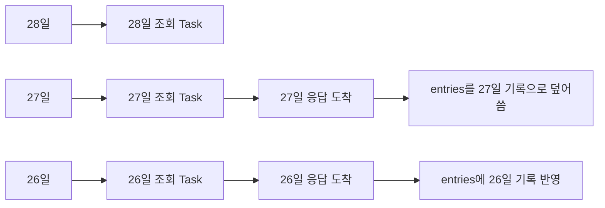

`DailyEntriesView`의 비동기 처리를 다듬으면서, 날짜 조회와 완료 상태 변경이 겹칠 때 생기는 문제를 단계적으로 해결했다. 9월 18일에 조회 취소와 중복 요청 방지를 먼저 적용했고, 9월 28일에 입력 잠금 상태를 분리한 뒤 9월 29일에 로딩 상태와 실패 처리를 더 정리했다.

1. 날짜 전환을 빠르게 하면, 먼저 시작한 조회가 나중에 끝날 수 있다.
2. 완료 상태 변경이 저장되기 전에 완료 버튼을 누를 수 있다.

날짜를 전환하면, 가장 최근에 전환된 날짜의 목록을 보여줘야 한다. 예를 들어서 9월 26일 날짜를 보고 싶은데 9월 28일 -> 27일 -> 26일 순서대로 스와이프 해서 이동하면, 각 날짜의 `HabitEntry`를 로드하는 비동기 태스크가 쌓인다.



문제는 응답 순서가 보장되지 않는다는 점이다. 26일 결과가 먼저 도착해 화면에 반영된 뒤, 27일 결과가 늦게 도착하면 선택한 날짜는 26일인데 화면에는 27일의 엔트리가 표시될 수 있다.

엔트리에 있는 완료 버튼도 문제다. 완료 버튼을 눌렀을 때, 아직 DB에 반영되기 전에 버튼을 한번 또 누를 수 있다. 완료 기록 자체가 단순히 상태가 아니라(상태여도 문제지만) 하나의 데이터로 저장되기 때문에 중복된 `Completion`이 생성될 수 있다.

## 이전 조회 결과를 반영하지 않기

9월 27일 조회를 시작하고 바로 9월 26일로 이동했다고 하자. 26일 결과가 먼저 도착한 뒤 27일 결과가 도착하면, 제목은 26일인데 `entries`은 27일의 기록을 가지고 있을 수 있다.

9월 18일에 날짜 조회 Task를 `entriesLoadTask`에 보관하도록 바꿨다. 새 날짜를 선택하면 이전 Task에 취소를 요청하고, 새 Task가 최신 날짜를 조회하게 했다.

```swift
func selectDay(_ day: LocalDay) async {
    selectedDay = day
    await loadEntries(for: day)
}

private func loadEntries(for day: LocalDay) async {
    entriesLoadTask?.cancel()

    let task = Task { [weak self] in
        guard let self else { return }
        await self.performEntriesLoad(for: day)
    }
    entriesLoadTask = task
    await task.value
}
```

이전 조회를 취소하는 이유는 결과를 무시하기 위해서이면서, 더 이상 필요 없는 작업을 줄이기 위해서이기도 하다. 다만 [Swift Concurrency의 cooperative cancellation]()처럼 `cancel()`은 Task를 즉시 멈추지 않는다. 조회가 성공해 돌아와도 결과를 반영하기 전에 취소 여부를 확인해야 한다.

취소된 Task가 뒤늦게 실패한 경우에는 오류도 표시하지 않는다.

```swift
let loadedEntries = try await loadEntriesForDayUseCase.execute(on: day)
guard !Task.isCancelled else { return }
entries = loadedEntries
```

이 규칙은 지연되는 레포지토리로 확인했다. 18일 조회를 멈춰 둔 사이 19일 조회를 끝내고, 마지막에 18일 조회를 재개해도 `entries`는 19일 기록이어야 한다.

## 하나의 `isLoading`으로는 부족했다

9월 18일에는 `perform`에서 `isLoading`을 확인해 중복 변경 요청을 막았다. 날짜 조회 Task는 `perform`과 별도로 실행했지만, 조회와 변경 작업은 여전히 하나의 `isLoading`을 공유했다.

```swift
private func perform(_ operation: @escaping () async throws -> Void) async -> Bool {
    guard !isLoading else { return false }

    isLoading = true
    defer { isLoading = false }
    // Completion 변경과 Habit 생성
}

private func performEntriesLoad(for day: LocalDay) async {
    isLoading = true
    defer {
        if !Task.isCancelled {
            isLoading = false
            entriesLoadTask = nil
        }
    }
    // 날짜 조회와 취소 확인
}
```

예를 들어, `Completion` 저장이 진행 중일 때 날짜 조회가 끝나 `isLoading = false`가 되면, 저장은 아직 끝나지 않았는데 두 번째 완료 탭을 받을 수 있다.  반대로 `isLoading`만 보고는 목록이 새 날짜를 기다리는 중인지, `Completion`을 저장하는 중인지 알 수 없다.

이때 이전 날짜의 `HabitEntry`를 곧바로 `entries = []`로 지우는 방법도 생각했는데, 그러면 이전 행을 잘못 누를 수는 없지만, 날짜를 움직일 때마다 목록 행이 사라졌다 다시 만들어진다. 기존 행을 유지하면서 전환 중의 입력을 막기로 했다.

### 조회와 변경 작업 상태 분리

조회와 변경은 동시에 끝날 수 있으므로, 상태는 각각 추적해야 한다. 다만 목록의 항목 액션은 어느 한쪽이라도 진행 중이면 실행되면 안 된다. 그래서 9월 28일 `DailyEntriesViewModel`에 작업별 플래그를 두고, 사용자 입력에 필요한 잠금 상태를 계산하도록 수정했다:

```swift
private(set) var isEntriesLoading = false
private(set) var isPerformingMutation = false

var isEntryInteractionLocked: Bool {
    isEntriesLoading || isPerformingMutation
}
```

날짜 조회는 `isEntriesLoading`만 설정한다. 이전 태스크가 취소되었을 때,  다른 조회가 실행 중일 수 있으므로, 취소된 태스크가 로딩 상태를 끝내면 안된다:

```swift
private func performEntriesLoad(for day: LocalDay) async {
    isEntriesLoading = true
    defer {
        if !Task.isCancelled {
            isEntriesLoading = false
            entriesLoadTask = nil
        }
    }
    // 조회와 취소 확인
}
```

`Completion` 기록, 취소와 `Habit` 생성은 변경 작업 상태를 쓴다. 목록 조회 중이거나 다른 변경 작업이 진행 중이면 새 변경 요청은 실행하지 않는다.

```swift
private func perform(_ operation: @escaping () async throws -> Void) async -> Bool {
    guard !isEntryInteractionLocked else { return false }

    isPerformingMutation = true
    defer { isPerformingMutation = false }

    do {
        try await operation()
        return true
    } catch {
        alert = .operationFailed(String(describing: error))
        return false
    }
}
```

`DailyEntriesView`에서는 목록과 Habit 추가 버튼에 `isEntryInteractionLocked`를 적용했다.

`DailyEntriesViewModel.detailTapped(_:)`도 같은 값을 확인한다. 로딩 중에 이전 날짜의 행이 잠시 남아 있어도 완료 버튼과 상세 진입은 동작하지 않는다.

```swift
List {
    // HabitEntry 행
}
.disabled(viewModel.isEntryInteractionLocked)
```

## 테스트

한 번만 실행해야 하는 작업은 첫 `Completion` 저장을 멈춰 둔 뒤 같은 `HabitEntry`를 다시 탭해 확인했다. `insertCount`는 하나여야 한다.

더 중요한 경우는 저장과 날짜 조회가 겹칠 때다. `Completion` 저장을 멈춰 둔 상태에서 다른 날짜를 조회하고, 조회만 먼저 끝낸다.

```swift
let firstTap = Task { await viewModel.entryTapped(entry) }
await completionRepository.waitForFirstInsert()
await viewModel.selectDay(secondDay)

#expect(!viewModel.isEntriesLoading)
#expect(viewModel.isPerformingMutation)
#expect(viewModel.isEntryInteractionLocked)
```

리스트 조회가 끝났어도 `Completion` 저장이 남아 있으므로 락은 유지되어야 한다. 이 상태에서 같은 엔트리를 다시 탭해도 저장 횟수가 늘지 않는지 확인했다.

## 정리

Daily feature 에서는 날짜별 엔트리 조회와 `Completion` 변경이 동시에 진행될 수 있다. 최근에 선택한 날짜의 결과만 반영하도록 조회 태스크를 취소하고, 변경 작업은 중복 실행을 막았다.

이후 두 작업이 하나의 `isLoading`을 공유하면 종료 순서에 따라 잠금이 풀릴 수 있음을 확인했다. `isEntriesLoading`과 `isPerformingMutation`을 나누고, 뷰에서 필요한 잠금 상태는 두 값으로 계산한다.

날짜를 넘어갈 때 마다 엔트리를 아예 비워버리는 방법도 생각했었는데, 그건 좀 아닌 것 같았다. 예전에 하던 어떤 프로젝트도 셀 재사용을 대놓고 포기하진 않아서 그렇게 하진 않았다...

여기까지는 9월 28일 코드 기준이다. 조회와 변경은 동시에 존재할 수 있는 서로 다른 상태 축이라, 하나의 이뉴머레이션으로 합치면 가능한 조합을 계속 추가해야 한다. 9월 29일에는 각 축을 `LoadState`, `MutationState` 이뉴머레이션으로 표현하고 로딩 실패와 재시도를 처리했다. 또한 엔트리와 조회한 날짜를 함께 보관해 날짜 변경에 실패했을 때 이전 데이터가 어느 날짜에 속하는지 구분했다.
