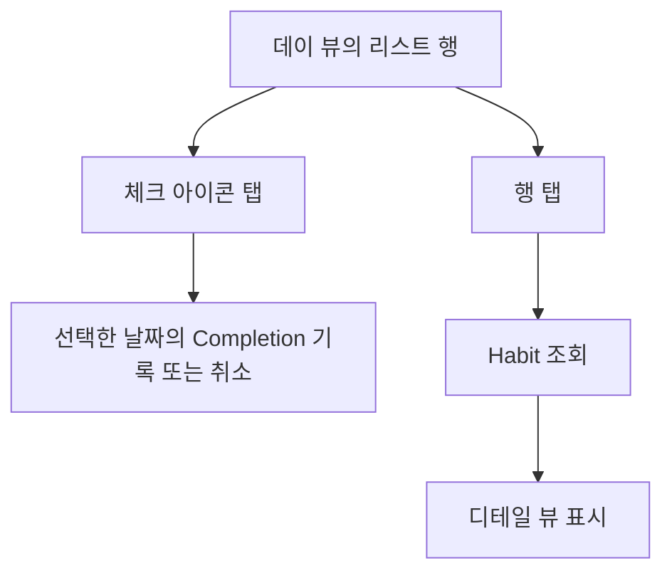
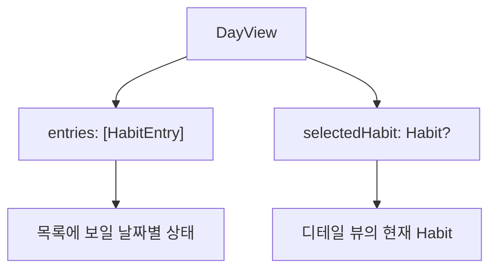

MVP에서 데이 뷰의 리스트 행에는 두 가지 동작이 필요하다.



디테일 뷰에서는 이름을 바꾸고, 추적 기간을 확인하고, 그날의 완료 상태도 볼 수 있어야 한다. 따라서 리스트에 이미 있는 `HabitEntry`만으로 디테일 뷰를 만들순 없고 `Habit`을 가져와야 한다.

이번 작업에서는 데이 뷰의 리스트에서 선택한 `Habit`을 읽어 디테일 뷰를 구성하는 흐름을 만들었다.

## 데이 뷰의 HabitEntry는 특정 날짜의 상태

우선 리스트를 생성할 때는 `Habit`이 아닌 `HabitEntry`를 사용한다.

```swift
@ViewBuilder
private func entrySection(title: String?, entries: [HabitEntry]) -> some View {
    if !entries.isEmpty {
        if let title {
            Section(title) { entryRows(entries) }
        } else {
            Section { entryRows(entries) }
        }
    }
}
```

`HabitEntry`에는 이름과 완료 상태처럼 리스트에 필요한 값은 있지만 (애초에 용도가 그 용도니까), `Habit` 생성일, 추적 기간, 보관 상태처럼 디테일 뷰에 필요한 값은 없다.

그러면 필요한 정보를 어떻게 가져와야 할까? `HabitEntry`에 값을 더 추가하는 것은 진짜 별로고, 결국에는 `HabitRepository`에서 `Habit`을 조회해야 한다.

## Habit 다시 조회

디테일 뷰를 띄우기 위한 유즈케이스는 `Habit.ID`만 받아 Repository에서 `Habit`을 조회한다.

유즈케이스가 `fetch`를 감싼 것 뿐인데, 굳이 필요한가? 라는 생각도 들긴 하는데, 나중에 어떻게 확장될 지 모르고, 보일러 플레이트가 엄청 큰 것도 아니니까 유즈케이스로 뒀다:

```swift
struct LoadHabitDetailUseCase {
    private let habitRepository: any HabitRepository

    func execute(id: Habit.ID) async throws -> Habit {
        guard let habit = try await habitRepository.fetch(id: id) else {
            throw LoadHabitError.habitNotFound
        }
        return habit
    }
}
```

`DayViewModel`에서는 선택한 `HabitEntry`의 `habitID`만 전달해서 유즈케이스를 호출할 수 있다:

```swift
func habitDetailRequested(for entry: HabitEntry) async {
    await perform {
        self.selectedHabit = try await self.loadHabitDetailUseCase.execute(
            id: entry.habitID
        )
    }
}
```

데이 뷰의 리스트는 계속 `HabitEntry` 배열로 유지하고, 디테일 뷰에서만 `selectedHabit`을 별도로 가진다.



## DetailView 구성하기

디테일 뷰의 완료 버튼은 여전히 현재 선택한 날짜의 `HabitEntry`의 `state`가 필요하고, 제목, 추적 기간, 이름 변경 대상은 `Habit`이 필요하다.

```swift
HabitDetailView(
    habit: habit,
    completionState: entry.state,
    onCompletionTap: { /* 현재 날짜의 Completion 변경 */ },
    onNameSubmit: { name in /* Habit 이름 변경 */ }
)
```

| 값 | 설명 |
| --- | --- |
| `Habit` | 지금 존재하는 Habit의 정보 |
| `HabitEntry.State` | 선택한 날짜에 완료 버튼이 보여야 할 상태 |

완료 버튼을 누르면 `HabitEntry`가 가진 `targetDay`를 기준으로 `Completion`을 기록하거나 취소한다. 

이름을 바꾸면 `Habit` 자체를 변경한다. 둘은 같은 화면에서 함께 보이지만 변경하는 대상과 기준 날짜가 다르다.

## Edit 동작

처음에 디테일 뷰에서 `Habit`의 이름을 변경하는 동작을 편집 버튼과 저장·취소 버튼을 따로 두는 방식으로 만들었다:



그런데 굳이 버튼을 추가해서 확인/취소를 받을 필요가 없어보여서 바로 `TextField`로 제목을 띄워서 바로 편집 가능하게 했다...



입력한 문자열은 `RenameHabitUseCase`를 거쳐서 레포지토리에 반영된다. 

```swift
TextField("Habit name", text: $editedName)
    .submitLabel(.done)
    .onSubmit { saveEditedName() }
```

나중에 `Habit`의 다른 부분도 수정할 수 있게 될텐데, 그러면 `RenameHabitUseCase`라는 것은 스코프가 너무 좁아보여서 이름을 `EditHaibtUseCase`로 바꿀까 고민도 했는데... 실제 그 기능이 구현될 때 바꾸기로 했다:

```swift
func execute(habitID: Habit.ID, name: String) async throws -> Habit {
    guard var habit = try await habitRepository.fetch(id: habitID) else {
        throw RenameHabitError.habitNotFound
    }

    try habit.rename(to: name, updatedAt: clock.now)
    try await habitRepository.update(habit)
    return habit
}
```

변경이 끝나면 뷰 모델은 디테일 뷰의 `Habit`을 반환값으로 교체하고, 데이 뷰의 목록도 다시 읽는다:

```swift
self.selectedHabit = try await self.renameHabitUseCase.execute(
    habitID: habitID,
    name: name
)
try await self.loadEntries()
```



## List vs. VStack + ScrollView



디테일 뷰를 구성할 때, `List`를 쓸까 `VStack`을 쓸까 고민했다.

우선 디테일 뷰에는 추적 기간, 반복 주기, 보관과 삭제처럼 서로 다른 성격의 정보와 동작이 들어간다. 

MVP 단계에서는 디테일 뷰에 인터랙션이 크게 없는데, 나중에 인터랙션이 추가되었을 때 `List`를 쓰게 되면, 이런 서로 다른 액션들을 관리하기가 좀 애매해진다.

항목의 개수가 동적으로 결정되는 것도 아니기 때문에 `ScrollView`와 `VStack`을 써서 구성했다:

```swift
ScrollView {
    VStack(alignment: .leading, spacing: 0) {
        habitHeader
        Divider()
            .padding(.top, 28)
        detailRow(
            icon: "calendar",
            title: "Tracking period",
            value: trackingPeriod
        )
        Divider()
        detailRow(
            icon: "arrow.trianglehead.2.clockwise.rotate.90",
            title: "Repeat",
            value: "매일"
        )
        //...
    }
}
```

물론 `List`를 안썼다고, 각 Row를 재사용 하지 말란 법은 없으니까, `detailRow`로 만들어서 잘 재사용 했다.

## 정리

데이 뷰의 리스트는 선택한 날짜의 상태를 보여 주는 `HabitEntry`를 유지하고, 디테일 뷰를 열 때만 `Habit`을 다시 읽도록 했다. 그래서 완료 버튼은 날짜별 `Completion`을 바꾸고, 이름 변경은 `Habit`을 수정한다. 한 화면에 놓인 동작이지만, 각 동작이 다루는 원본은 섞이지 않는다.

디테일 뷰를 만들면서 이름 편집 방식도 한 번 바뀌었다. 굳이 여러 단계를 추가하는 것 보다는 그냥 바로 수정 가능하도록 했다.

뷰는 정적인 값과 액션들을 보여주기 때문에 `List`보다 `ScrollView`와 `VStack`이 더 잘 맞았다. 

뭔가 엄청난 인사이트를 얻거나 그런 작업은 아니었다. 그래도 예전에 (특히 SniffMEET때) 저런 리스트 형태면 거의 무조건 `UITableView`를 썼는데, 이제는 더 생각을 해보고 결정하게 되었다 정도.
