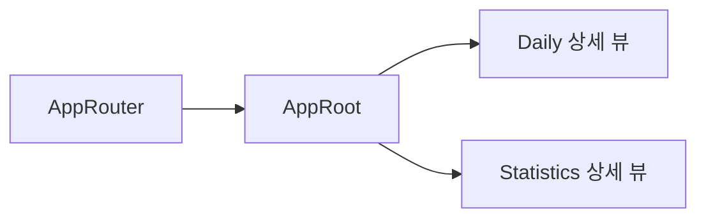
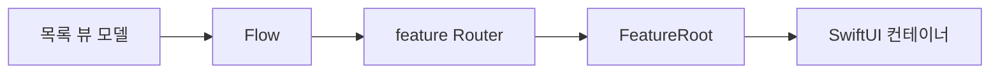
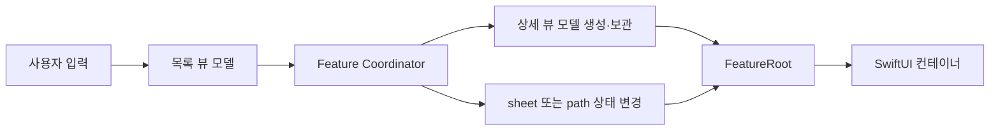
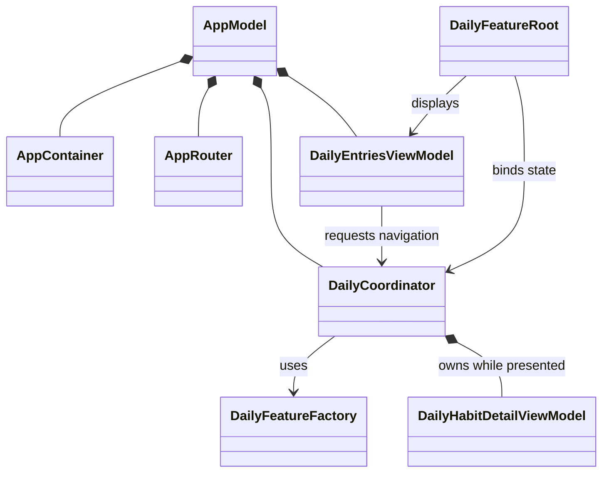

[AppRouter를 도입한 뒤](), 앱 내부의 모든 화면 전환 상태를 한 곳에 모았다. `AppRouter`가 전환 상태만 보관하고, `AppRoot`가 route에 맞춰 상세 뷰와 상세 뷰 모델을 조립한다.



하지만 `AppRouter`로 전환 상태를 분리했을 뿐, `DailyHabitDetailView`와 `HabitStatisticsDetailView`가 커질수록 `AppRoot`도 두 feature의 상세 화면을 너무 많이 알게 된다.

당시 `AppRoot`는 route를 받아 상세 화면에 필요한 상태와 동작을 조립했다. 예를 들어 Daily feature 에서는 `DailyHabitDetailView`의 상태를 읽고, 이름 변경·보관·삭제 동작을 각각 클로저로 연결한다:

```swift
private func dailyHabitDetail(habitID: Habit.ID, app: AppModel) -> some View {
    let viewModel = app.dailyEntriesViewModel

    if let habit = viewModel.selectedHabit,
       let entry = viewModel.entries.first(where: { $0.habitID == habitID }) {
        DailyHabitDetailView(
            habit: habit,
            completionState: entry.state,
            onNameSubmit: { name in
                Task { await viewModel.habitRenamed(habitID: habitID, name: name) }
            },
            onArchive: {
                Task {
                    if await viewModel.habitArchived(habitID: habitID) {
                        app.router.dismissDailySheet()
                    }
                }
            }
            // 삭제, 완료 기록 변경 등의 동작도 같은 방식으로 연결
        )
    }
}
```

이런 방식은 필요한 유즈케이스, 상세 뷰 모델 생성, 내비게이션 동작까지 앱 루트에 모이게 된다.

이번에는 조립 책임을 각 feature 안으로 옮겼다. Router를 더 잘게 쪼갤지, 별도 Flow를 둘지, Coordinator가 맡을지를 고민했다. 

결론부터 말하자면, Router를 추가하는 대신에 상세 뷰 모델의 생성과 생명주기까지 관리하는 feature별 Coordinator를 만들었다.

## AppRouter 작성 이후 남아 있는 문제

`AppRouter`를 도입해도 다음 문제는 남아 있었다.

- `AppRoot`가 Daily와 Statistics의 상세 화면을 모두 조립한다.
- 목록 뷰 모델이 상세 화면 전용 상태와 동작까지 함께 가진다.
- 상세 화면의 유즈케이스와 뷰 모델을 언제 만들고 비울지 정하는 코드가 feature 밖에 있다.

이전 구조의 `AppRoot`는 route에 든 `Habit.ID`를 받고, 해당 feature의 목록 뷰 모델에서 상세에 필요한 값을 꺼내 뷰를 만들었다:

특히 `HabitStatisticsDetailView`는 summary, 통계, 월간 캘린더, 로딩 상태, 삭제 뒤 화면을 닫는 동작까지 모두 필요했다:

```swift
if let summary = viewModel.summary(for: habitID) {
    HabitStatisticsDetailView(
        summary: summary,
        statistics: viewModel.selectedHabitStatistics,
        calendar: viewModel.selectedHabitMonthlyCalendar,
        isLoading: viewModel.isLoading,
        // ...
    )
}
```

이런 구조는 `AppRoot`가 앱 전역의 탭 컨테이너이면서 Daily와 Statistics의 상세 구현을 알게 된다. 

이 때문에 기능 하나를 추가했을 때 뷰 모델, `AppRoot`의 조립 코드, route 연결까지도 함께 수정을 해야하는 문제가 발생한다.

## 조립/소유

### 뷰 모델 분리

이전에는 하나의 뷰 모델이 여러 뷰에 필요한 상태를 가지고 있었다. 따라서 `AppRoot`는 뷰 모델의 상태를 읽고, 다른 뷰에 필요한 값과 동작을 각각 꺼내 클로저나 프로퍼티로 전달하는 방식으로 뷰를 구성했다.

예시로 들면, `DailyHabitDetailView`의 뷰 모델이 따로 존재하지 않았다. `DailyEntriesViewModel`이 목록 조회뿐 아니라 상세의 Habit 조회·이름 변경·보관·삭제까지 맡고, `AppRoot`가 이 메소드를 상세 뷰의 클로저로 전달했다.

```swift
private let loadHabitUseCase: LoadHabitUseCase
private let renameHabitUseCase: RenameHabitUseCase
private let archiveHabitUseCase: ArchiveHabitUseCase
private let deleteHabitUseCase: DeleteHabitUseCase

private(set) var selectedHabit: Habit?

func habitDetailRequested(for entry: HabitEntry) async { /* ... */ }
func habitRenamed(habitID: Habit.ID, name: String) async { /* ... */ }
func habitArchived(habitID: Habit.ID) async -> Bool { /* ... */ }
func habitDeleted(habitID: Habit.ID) async -> Bool { /* ... */ }
```

즉, 2개 이상의 뷰의 상태가 하나로 뭉쳐 있는 상태가 된다.

물론, 잘못 만든 것은 아니고 처음에 `DailyHabitDetailView`에 기능이 별로 없을 때 너무 코드를 잘게 쪼개지 않기 위해서 사용한 방식의 흔적이다.

하지만 이제 뷰 모델을 분리할 때가 되었으므로, 이름 변경·보관·삭제처럼 상세 화면에서만 쓰는 동작은 `DailyHabitDetailViewModel`로 옮겼다.

```swift
@MainActor
@Observable
final class DailyHabitDetailViewModel {
    let id: Habit.ID
    private(set) var habit: Habit?
    private(set) var entry: HabitEntry?

    func completionTapped() async { /* ... */ }
    func renameHabit(name: String) async { /* ... */ }
    func archiveHabit() async -> Bool { /* ... */ }
    func deleteHabit() async -> Bool { /* ... */ }
}
```

Statistics feature도 개요 목록과 summary는 `StatisticsViewModel`에 남기고, 선택한 Habit의 통계·월간 캘린더·생명주기 동작은 `HabitStatisticsDetailViewModel`이 맡도록 분리했다.

모든 것을 feature별로 복제한 것은 아니다. 레포지토리, `Clock`, `TimeZone`처럼 앱 전체에서 공유하는 기반 의존성은 여전히 `AppContainer`에 남긴다. 반면 화면이 표시되는 동안에만 필요한 상세 상태와 유즈케이스는 상세 뷰 모델로, 전환 상태는 Coordinator로, SwiftUI 컨테이너 연결은 feature root로 옮겼다. 분리 기준은 타입의 이름이 아니라 누가 그 상태를 필요로 하고 언제까지 살아야 하는가였다.

### 인스턴스 생성과 소유 분리하기

처음에는 `AppContainer`에서 레포지토리부터 각 feature의 유즈케이스와 뷰 모델까지 전부 만들었다. 

하지만 레포지토리와 유즈케이스는 같은 종류의 의존성이 아니다. 레포지토리, `Clock`, `TimeZone`처럼 앱 전체에서 공유하는 기반 의존성은 오래 살아야 하고, 유즈케이스와 뷰 모델은 feature가 필요한 조합에 따라 만들어진다.

앱 시작점이 각 feature가 사용하는 모든 유즈케이스를 알 필요도 없다. 기반 의존성만 `AppContainer`에 두고, feature에 필요한 유즈케이스와 뷰 모델은 feature factory가 조립하도록 하려고 한다.

먼저 인스턴스를 두 부류로 나눴다.

- `AppContainer`는 레포지토리, `Clock`, `TimeZone`, `StatisticsCalculator`처럼 앱 전체에서 공유하는 기반 의존성을 만든다.
- `DailyFeatureFactory`와 `StatisticsFeatureFactory`는 각 feature에서 필요한 유즈케이스와 뷰 모델을 조립한다.

Factory는 앱 상태를 소유하지 않는다. `AppModel`을 초기화하는 동안 필요한 뷰 모델과 Coordinator를 만들고 나면, Factory 자체도 보관할 필요가 없다.

반면 `AppModel`은 `AppContainer`, `AppRouter`, 두 Coordinator, 두 목록 뷰 모델이 앱이 살아 있는 동안 유지될 수 있도록 보관한다.

```swift
@MainActor
final class AppModel {
    let container: AppContainer
    let appRouter: AppRouter
    let dailyCoordinator: DailyCoordinator
    let statisticsCoordinator: StatisticsCoordinator
    let dailyEntriesViewModel: DailyEntriesViewModel
    let statisticsViewModel: StatisticsViewModel
}
```

#### feature 사이에서 유즈케이스를 공유해야 할까?

`DeleteHabitUseCase`같은 경우에는 Daily, Statistics feature 둘 다 필요로 한다. 따라서 '`DeleteHabitUseCase`를 앱 전역에서 하나만 만들고 공유해야 하나?'라는 고민을 했다.

하지만 `AppContainer`는 기반 의존성만을 제공한다. feature별 필요한 의존성을 관리하지 않는다.

유즈케이스는 현재 상태를 보관하지 않는 스트럭처다. 따라서 필요한 feature에서 필요한 때 조립해도 되고, 인스턴스 하나를 공유해서 얻는 이득도 크지 않다.

정말 공유해야 하는 레포지토리와 `Clock`은 이미 `AppContainer`가 같은 인스턴스로 제공한다. 그래서 Daily와 Statistics feature가 각각 `DeleteHabitUseCase`를 만들어도, 결국 같은 저장소를 사용한다. 유즈케이스를 전역으로 끌어올리지 않아도 되는 이유다.

## 내비게이션/프레젠테이션

### Flow와 Router - 미채택

처음에는 feature별 `DailyRouter`, `StatisticsRouter`를 만들고, 상세 뷰 모델을 준비하는 `Flow`를 따로 두는 방법을 생각했다.



관심사 분리 측면에서는 나쁘지 않은 것 같다. Router는 표시 상태만 바꾸고, Flow는 '상세 화면을 열 수 있는가?'를 판단하며 상세 뷰 모델을 만드는 방식이다.

하지만 StackDay에서 Flow는 실제 도메인 흐름을 갖기보다, 상세 뷰 모델을 만들고 Router를 호출하는 중간 객체가 될 가능성이 컸다. Flow가 Router를 알아야 하는지, 아니면 `FeatureRoot`가 두 객체를 순서대로 호출해야 하는지도 새 고민이 됐다.

객체 하나를 더 만들었는데 조립 순서만 다른 곳으로 옮겨지는 셈이었다. 이 단계에서는 Flow와 Router를 나누며 생기는 연결 코드보다, 전환 상태와 상세 뷰 모델의 생명주기를 한 객체에서 함께 다루는 편이 더 단순하다고 판단했다.

### Coordinator로 전환 로직 옮기기

`AppRouter`는 화면 전환 상태를 나타내는 단순한 객체다:

AppRouter를 처음 도입했을 때는 탭뿐 아니라 Daily의 sheet·cover와 Statistics의 navigation path까지 모두 보관했다.

```swift
final class AppRouter {
    var selectedTab: Tab = .dailyEntries
    var dailySheet: DailySheet?
    var fullScreenCover: FullScreenCover?
    var statisticsPath: [StatisticsRoute] = []
}
```

전환 상태 자체는 한곳에 모였지만, 각 route에 맞는 상세 뷰 모델을 만들고 상세 뷰를 조립하는 책임은 여전히 `AppRoot`에 남았다. 앱 전역 Router가 feature 내부 화면의 세부 상태까지 계속 알게 되는 점도 경계가 흐려지는 신호였다.

```swift
@MainActor
@Observable
final class AppRouter {
    var selectedTab: Tab = .dailyEntries
}
```

feature별 Router와 Flow를 따로 두는 방법도 가능하다. 다만 현재 규모에서는 전환 상태를 가진 Router, 상세 뷰 모델을 만드는 Flow, 둘을 연결하는 코드까지 늘어나게 되지만, 보일러 플레이트를 크게 늘리고 싶지 않다.

상세 화면을 열 때는 `HabitEntry`나 `HabitStatisticsSummary`로 뷰 모델을 만들고, 닫힐 때는 그 뷰 모델을 비워야 한다. 이 둘이 같은 생명주기를 가지므로, 지금은 그 책임을 Coordinator 하나에 두는 결합을 감수하기로 했다.

Daily feature에서는 `DailyCoordinator`가 sheet 상태와 상세 뷰 모델을 함께 보관한다.

```swift
func presentHabitDetail(for entry: HabitEntry) {
    detailViewModel = factory.makeHabitDetailViewModel(
        habitID: entry.habitID,
        targetDay: entry.targetDay
    )
}

func dismissHabitDetail() {
    detailViewModel = nil
}
```

Statistics도 같은 방식이다. `StatisticsCoordinator`는 상세 뷰 모델을 만든 뒤 `.habitDetail` route를 path에 추가한다. path가 비면 `detailViewModel`도 비운다.

```swift
func showHabitStatistics(summary: HabitStatisticsSummary) {
    detailViewModel = factory.makeHabitDetailViewModel(summary: summary)
    statisticsPath.append(.habitDetail)
}
```

이제 route는 어떤 상세 화면이 보이는지만 표현하면 된다. 실제로 필요한 상세 상태는 Coordinator가 소유한 뷰 모델에 있다. 

만약 이 객체의 이름을 Router로 유지했다면, Factory 의존성과 상세 뷰 모델의 생명주기까지 가진 Router가 된다. 역할이 이미 Coordinator에 가까웠기 때문에 그 이름을 택했다.

### FeatureRoot가 SwiftUI에 연결하기

현재 화면 이동의 흐름은 다음과 같다.



목록 뷰 모델은 사용자 입력을 Coordinator에 전달한다. Coordinator는 상세 뷰 모델과 전환 상태를 바꾸고, `FeatureRoot`는 그 상태를 관찰해 SwiftUI 컨테이너에 바인딩한다. 상세 뷰 모델을 어떻게 만들지와 SwiftUI의 `sheet`, `NavigationStack`을 어떻게 연결하는지는 서로 다른 위치에 남는다.

`DailyFeatureRoot`는 Coordinator 상태를 SwiftUI 컨테이너에 연결하고, 화면이 닫힌 뒤 목록을 새로 읽는다.

```swift
.sheet(
    item: $router.detailViewModel,
    onDismiss: {
        router.dismissHabitDetail()
        Task { await viewModel.refreshEntries() }
    }
) { detailViewModel in
    DailyHabitDetailView(
        viewModel: detailViewModel,
        onArchiveOrDelete: router.dismissHabitDetail
    )
}
```

`StatisticsFeatureRoot`도 `statisticsPath`를 `NavigationStack(path:)`에 바인딩하고, 상세에서 돌아와 path가 비면 개요 summary를 다시 읽는다. 

이렇게 하면 sheet, cover, path 같은 SwiftUI API의 세부 사항은 feature root에만 남길 수 있다.

## 트레이드오프

Coordinator를 도입했다고 모든 문제가 사라진 것은 아니다. 뷰 모델이 Coordinator를 의존하므로, 뷰 모델을 완전히 화면 전환과 무관한 타입으로 두지는 못한다.

Daily feature를 기준으로 보면 객체 관계는 다음과 같다.



Stack Day에서는 Daily의 sheet와 Statistics의 navigation path가 서로 다르고, `DailyHabitDetailViewModel`은 뷰가 떠 있는 동안만 유지하면 된다.

이 상태와 생명주기를 feature마다 한 곳에서 관리하는 편이, `AppRoot`에 조립 코드를 남기거나 Flow와 Router를 모두 도입하는 것보다 현재 규모에 맞다고 판단했다.

## 정리

AppRouter를 도입하면서 화면 전환 상태를 뷰와 뷰 모델에서 분리했지만, `AppRoot`에는 feature별 상세 화면을 조립하는 책임이 남아 있었다. 상세 화면이 커질수록 그 책임도 함께 커졌다.

이번 변경에서는 공유 기반 의존성은 `AppContainer`에 남기고, feature별 유즈케이스와 뷰 모델은 factory가 조립하게 했다. 목록과 상세의 상태는 각각의 뷰 모델로 나누고, 상세 뷰 모델의 생성·생명주기와 feature 내부 전환 상태는 Coordinator가 관리한다. feature root는 이 상태를 SwiftUI 컨테이너에 연결한다.

그 결과 앱 전역의 `AppRouter`에는 탭 선택만 남고, Daily의 sheet와 Statistics의 navigation path 및 상세 화면 조립은 해당 feature 안에 모였다. 더 많은 패턴을 적용하는 것이 목표는 아니었다. 각 객체가 무엇을 만들고, 무엇을 보관하며, 언제까지 살아야 하는지를 코드에서 찾을 수 있게 만드는 것이 목표였다.
