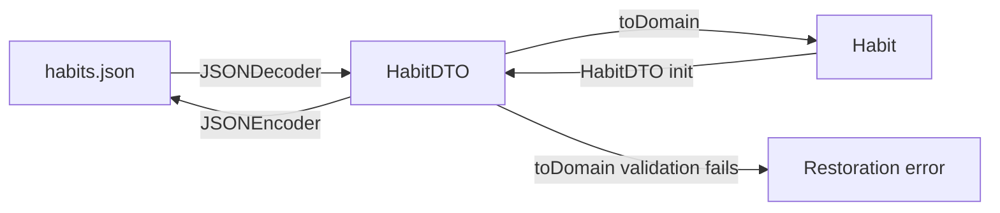

MVP의 마지막 단계에서 앱을 다시 열어도 `Habit`과 `Completion`이 남도록 데이터에 영속성을 붙였다. 

[DevBox에 영속성을 붙일 때와]() 마찬가지로 영속성을 가장 마지막에 붙이는건 내 스타일이다. 앱이 데이터 저장 방식에 휘둘리지 않을 수 있다. 

물론 데이터 영속성을 붙이기 전까지 임시로 in-memory 레포지토리를 사용해야 한다.

## 어떤 방식을 사용할까?

먼저 지금 붙이는 영속성 저장소가 어떤 컨셉을 가지고 있는지 먼저 자문자답으로 확인했다.

#### Q: 지금 이 저장소 선택이 최종안인가?

A: 이건 미래를 모르므로 알 수가 없다.

#### Q: 개발 도중에 in-memory의 휘발성이 귀찮아서 도입하는가?

A: 반쯤 맞는 말인데, MVP의 막바지라서 더 미뤄서 구현할게 없다.

#### Q: 나중에 교체할 후보는 정해뒀는가?

A: 미리 어떤 스택을 쓸 건지 내정한 것이라 아키텍처 관점에서는 조금 그렇지만, 최종적으로 Swift Data를 쓸 계획이 있다.

로컬에 데이터 저장소를 붙이는 방식을 고민하면서 몇 개 추렸다. 사실 선택지가 많은 부분도 아니니까

### UserDefaults

가장 간단한건 UserDefaults다. 가장 빠르고 쉽게 쓸 수 있다. 여기에 쓰라고 있는 것은 아니지만

설정용 key-value 저장소라 `Habit`과 `Completion`처럼 여러 항목을 조회하고 수정하는 구조화된 앱 데이터를 저장하기에는 어색하다. Stack Day의 데이터는 무겁지 않지만, 배열 전체를 꺼내 수정하고 다시 저장하는 코드가 늘어날 수 있다.

막상 지금 생각해보니, 처음에 in-memory 말고 UserDefaults를 사용할 걸 그랬다...

### FileManager + JSON

FileManager와 JSON 파일을 이용해서 영속성을 구현하는 방식도 괜찮다. 간단하고, 가장 많이 써봤다. UserDefaults보다 훨씬 '로컬 저장소' 느낌이 있다.

다만 얘도 직접 DB를 만드는 일이므로, 추상화가 듬뿍 들어갔을 다른 DB 라이브러리보다 직접 처리해야할 것들이 많다.

### Swift Data

Swift Data는 사용하고 싶지만 아직 학습하지 않았다. 에이전트에 의존해서 이해도 없이 구현하는 것 보다는 지금 당장은 다른 방식을 사용하고, WWDC 세션이나 예제 코드를 몇 번 보고 공부한 다음 적용하려 한다.

레포지토리들이 DIP를 잘 지키고 있으니 교체가 하나도 어렵지 않다. 즉, 새로운 영속성 방식을 구현해야 해도 다른 앱 코드에 생기는 부담이 없다.

### Others

Core Data나 다른 서드파티 라이브러리들을 사용할 수도 있겠지만, Stack Day는 레거시 앱이 아니다.

## DTO 만들기

`Habit`을 그대로 JSON으로 매핑해서 저장하고 싶지 않았다. `Habit` 같은 도메인 모델은 앱에서 습관을 표현하기 위한 타입이고, JSON은 현재 저장 형식을 표현하기 위한 데이터다.

둘을 같은 타입으로 둘 수도 있지만, 특정값 누락 같은 레포지토리 레이어의 특이사항이 도메인 모델인 `Habit`에 들어오고, 도메인 모델이 변할 때 마다 기존 파일 형식까지 함께 변경되게 된다. 즉, 결합도가 엄청나게 증가한다.

이때, 현재 규칙에 맞지 않는 데이터는 `Habit`을 만들지 못한다. 저장 형식과 도메인 규칙 사이에 이 한 단계의 경계를 두기 위해 DTO를 사용했다:



별도의 `HabitMapper` 타입은 만들지 않았다. 지금 변환은 한 DTO와 한 도메인 타입 사이의 단순한 필드 매핑이고, 외부 설정이나 다른 저장소를 참조하는 로직도 없다. 

```swift
struct HabitDTO: Codable {
    let id: UUID
    let name: String
    let startedOn: LocalDay
    let trackingPeriods: [TrackingPeriodDTO]
    let createdAt: Date
    let updatedAt: Date

    func toDomain() throws -> Habit {
        try Habit(
            id: id,
            name: name,
            startedOn: startedOn,
            trackingPeriods: try trackingPeriods.map { try $0.toDomain() },
            createdAt: createdAt,
            updatedAt: updatedAt
        )
    }
}
```

나중에 DB 정규화를 하면 `TrackingPeriod`가 분리되는 것과 같은 상황은 도메인 모델과 DTO가 1:1 대응되지 않는 상황이므로, 확실히 Mapper가 필요하다. 그러면? 그 때 구현하면 된다. 지금 코드의 경계를 잘 지켜놓으면 된다.

`Completion`도 별도 DTO로 저장한다. 완료 기록은 습관에 포함시키지 않고 별도 저장소에 두던 기존 경계를 그대로 유지했다.

```swift
struct CompletionDTO: Codable {
    let id: UUID
    let habitID: Habit.ID
    let completedOn: LocalDay
    let recordedAt: Date

    init(_ completion: Completion) {
        id = completion.id
        habitID = completion.habitID
        completedOn = completion.completedOn
        recordedAt = completion.recordedAt
    }

    func toDomain() -> Completion {
        Completion(
            id: id,
            habitID: habitID,
            completedOn: completedOn,
            recordedAt: recordedAt
        )
    }
}
```

`Completion`은 현재 별도의 생성 검증이 없어서 복원은 실패하지 않는다. 그래도 `Habit`과 같은 방향으로 DTO를 둬서, 파일 형식이 바뀌더라도 저장소 경계 밖의 모델을 직접 바꿀 필요가 없게 했다.

## FileManager 기반 레포지토리 만들기

`FileHabitRepository`와 `FileCompletionRepository`는 in-memory 저장소와 같게 액터로 구현했다. 최소한 레포지토리 내부의 데이터는 데이터 레이스에서 보호된다.

이전에 devbox-light-server에서 적용했던 것 처럼 파일 쓰기 동작에서는 파일을 바로 덮어쓰지 않는다:

```swift
let temporaryURL = directoryURL.appendingPathComponent(
    ".habits-\(UUID().uuidString).tmp"
)
try data.write(to: temporaryURL)

if fileManager.fileExists(atPath: fileURL.path) {
    try fileManager.replaceItemAt(
        fileURL,
        withItemAt: temporaryURL
    )
} else {
    try fileManager.moveItem(at: temporaryURL, to: fileURL)
}
```

먼저 임시 파일에 완성된 JSON을 쓰고, 성공했을 때만 기존 파일과 교체한다. 

교체에 실패하면 임시 파일을 정리하고 오류를 던진다. 적어도 한 파일 안에서는 쓰다 만 JSON으로 기존 데이터를 망가뜨리지 않기 위한 선택이다. (DevBox 이전 버전에서도 적용했던 방식이다.)

### 동시성 문제

`FileManager`는 `Sendable`이 아닌 레퍼런스 타입이다. `AppEnvironment`가 보관한 인스턴스를 액터 타입인 레포지토리에 전달하면, 조립부의 non-isolated 접근과 액터 접근이 동시에 일어날 수 있다고 Swift 6 컴파일러가 판단한다:



이 진단은 `FileManager`의 일반 파일 작업에서 데이터 레이스가 반드시 발생한다는 뜻은 아니다. 다만 컴파일러는 공유된 non-Sendable 참조를 actor 경계 너머로 안전하게 전달할 수 있다고 증명할 수 없다.

따라서 각 레포지토리에 새 `FileManager()`를 만들어 주입했다, `JSONEncoder`, `JSONDecoder`도 같은 맥락이다:

```swift
directoryURL: directoryURL,
encoder: JSONEncoder(),
decoder: JSONDecoder(),
fileManager: FileManager()
```

## 앱 조립부에서 FileManager 사용하기

Stack Day에서 사용하는 두 레포지토리는 `HabitRepository`, `CompletionRepository` 프로토콜로 추상화 되어있기 때문에, 앱 조립부에서만 기존 in-memory에서 FileManager 기반으로 변경시키면 된다:

```swift
habitRepository = FileHabitRepository(
    directoryURL: directoryURL,
    encoder: JSONEncoder(),
    decoder: JSONDecoder(),
    fileManager: FileManager()
)
completionRepository = FileCompletionRepository(
    directoryURL: directoryURL,
    encoder: JSONEncoder(),
    decoder: JSONDecoder(),
    fileManager: FileManager()
)
```

파일 저장소를 선택하는 일은 `AppEnvironment`에 두었다. `AppContainer`는 환경에서 받은 레포지토리를 유스케이스에 조립한다. 

그래서 기존 in-memory 레포지토리와 테스트 더블은 그대로 남고(테스트용 레포지토리가 따로 존재한다), 앱 실행 환경에서만 FileManager 기반 구현체가 사용된다.

아직 보장하는 범위는 `Habit`을 저장하는 JSON 파일과 `Completion`을 저장하는 JSON을 파일을 읽고 쓰는 정도 까지다. 두 파일을 수정할 때의 원자성, 스키마 변경, 동기화는 아직 없다.

## 정리



이번 단계에서는 최종 저장소를 정하기보다, MVP가 앱 재실행 뒤에도 상태를 유지할 수 있는 최소한의 영속성을 구현했다.

일단 하나 반성해야 할 것이 in-memory를 너무 고집했나 생각이 들었다. 그냥 UserDefault로 했어도 휘발성 없는 영속성을 누리면서, 가볍게 개발 도중에 사용할 수 있었는데.

FileManager + JSON은 현재 MVP 요구에는 충분하다. 다만 여러 파일을 함께 바꾸는 원자성이나 스키마 변경 같은 요구가 생기면, SwiftData 같은 저장소로 옮기거나 구현을 확장해야 한다.

DTO를 도입했다. `Habit`과 `Completion`은 DTO로 파일 형식과 분리했고, 레포지토리 안에서 JSON을 읽고 쓴다. 쓰기는 임시 파일을 거쳐 기존 파일을 교체하도록 했다.

당연히 프로토콜 기반 추상화로 DIP를 적용해서, 레포지토리 구현체가 바뀌었다고 해서 앱 코드가 변할 일은 없다. Swift Data에서는 저장 로직이 프로퍼티 래퍼 형태로 뷰에 붙어있는 것 같던데, 이 부분은 생각좀 해봐야 할 것 같다.
