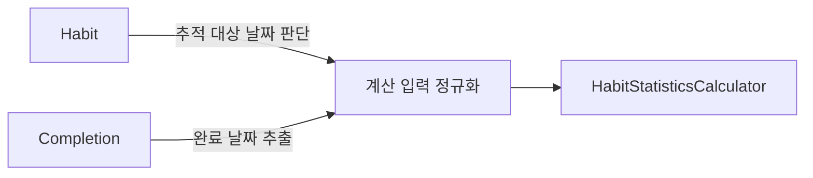

`HabitStatisticsCalculator`는 `Habit`, `[Completion]`, `referenceDay`를 받아서 통계를 계산한다. 

내부적으로는 `Habit`의 `TrackingPeriod`를 해석해 추적 일수를 구하고, 그 기간에 해당하는 완료 기록만 걸러내 완료율과 연속 기록을 계산한 뒤 `HabitStatistics`를 만들어 리턴한다:

```swift
struct HabitStatisticsCalculator {
    func calculate(
        habit: Habit,
        completions: [Completion],
        referenceDay: LocalDay
    ) throws -> HabitStatistics {
        let trackingDays = try trackingDays(for: habit, through: referenceDay)
        let trackingDaySet = Set(trackingDays)
        let eligibleTrackingDays = trackingDays.count
        let completedDays = Set<LocalDay>(completions.compactMap { completion in
            guard completion.habitID == habit.id,
                  trackingDaySet.contains(completion.completedOn)
            else { return nil }
            return completion.completedOn
        })
        let totalCompletedDays = completedDays.count
        let completionRate = eligibleTrackingDays == 0
            ? 0
            : Double(totalCompletedDays) / Double(eligibleTrackingDays)
        let streak = calculateStreak(
            trackingDays: trackingDays,
            completedDays: completedDays,
            referenceDay: referenceDay
        )

        return HabitStatistics(
            totalCompletedDays: totalCompletedDays,
            eligibleTrackingDays: eligibleTrackingDays,
            completionRate: completionRate,
            streak: streak
        )
    }
}
```

`calculate`를 호출하는 유즈케이스는 이 덕분에 단순해지지만, `HabitStatisticsCalculator`는 더 이상 순수한 계산 스트럭처가 아니게 된다:

- 보관, 복원을 보고 총 추적 일수 계산
- 기준일까지 유효한 날짜 범위 판단
- 완료 기록을 어느 기간에 포함시킬지 여부
- 위의 것들을 다 마치고서야 할 수 있는 통계 계산

즉, 통계 계산과는 별개로 도메인 로직들도 처리하고 있다.

## 첫 시도

원래는 `HabitStatisticsCalculator`가 도메인을 알고 있다기 보다는, 그냥 `calculate` 메소드가 커서 단순히 쪼개려고 했다.

항상 모든 통계 결과가 필요한 것은 아니기 때문에, 특정 상황에만 필요한 통계 결과를 묶은 `HabitCompletionSummary`와 같은 결과 타입을 만든 다음에, 여러 메소드들로 결과를 나누려 했다:

```swift
func calculateCompletionSummary(
    habit: Habit,
    completions: [Completion],
    referenceDay: LocalDay
) -> HabitCompletionSummary
```

계산 결과를 필요한 만큼만 꺼낼 수 있다는 점은 좋아 보였는데, 문제는 '추적 일수 계산'과 같은 도메인 값들이 내부에서 중복되어서 재사용을 할 수 없었다. 

이때서야 `HabitStatisticCalculator`가 처리해야할 작업 이상을 하고 있다는걸 알게 되어서, 기존 코드를 전부 뒤엎고 새로 만들기 시작했다.

## 기본 타입을 리턴하자

`HabitStatisticsCalculator`가 통계를 위해서 `Habit`과 `Completion`에 전처리 작업을 직접 하는 것도 문제지만, 리턴하는 값도 문제다.

특정 상황에서 특정 통계 값만 필요한 경우에, 실제로 그 값들만 리턴하고 있다. 즉, `HabitStatisticCalculator`가 뷰 기획까지 알고 있는 것이다.

최대한 통계를 순수하게 하려면, 특정 화면을 위한 모델 대신 `Int`나 `Double`같은 기본 타입을 리턴하는게 좋다고 판단했다. 

## HabitStatisticsCalculator는 Habit, Completion을 몰라도 된다

`HabitStatisticsCalculator`에서 `Habit`을 받고 있었는데, 다시 생각해보니 현 시점에서 굳이 `Habit`을 알 필요가 없었다.

```swift
func calculate(
    habit: Habit,
    completions: [Completion],
    referenceDay: LocalDay
) throws -> HabitStatistics
```

우선, `Habit`마다 통계 동작이 다르지 않다. 기획 중에 스트릭 보호 정책이나 이런 부분을 커스텀할 수 있게 만들었는데, MVP에는 아직 그 계획이 없다. 

나중에 생기더라도 `Habit` 자체는 여전히 필요하지 않다. 전략 패턴으로 일치하는 정책 객체를 넣으면 되니까. (그런데 이건 나중에 직접 해봐야 알 것 같기도 하다)

그러면 통계 계산에 필요한 것은 뭘까? 단순한 날짜와 완료 기록 뿐이다. 완료 기록도 `Completion` 처럼 복잡한 값일 필요 없고 그냥 완료한 '날짜'면 된다:

```swift
struct HabitStatisticsCalculator {
    func currentStreak(
        eligibleDays: [LocalDay],
        completedDays: Set<LocalDay>,
        referenceDay: LocalDay
    ) -> Int

    func longestStreak(
        eligibleDays: [LocalDay],
        completedDays: Set<LocalDay>
    ) -> Int

    func completionRate(
        completedDayCount: Int,
        eligibleDayCount: Int
    ) -> Double
}
```

이제 계산기가 아는 것은 다음의 세 가지뿐이다. 

1. 어떤 날짜들이 대상인가 
2. 그중 무엇을 완료했는가
3. 현재 연속 기록을 판단할 기준 날짜가 언제인가?

더 이상 `archivedOn`이나 `TrackingPeriod`, 레포지토리, `Habit.ID`는 필요 없다.

## 책임 분리하기

기존 `HabitStatisticsCalculator`의 책임은 세 곳으로 나뉘었다.

- `Habit`은 추적 기간의 이력을 가지고, 어느 날짜가 추적 대상인지 판단한다.
- 유즈케이스는 `Habit`과 `Completion`을 읽어 통계에 필요한 `LocalDay` 셋으로 만든다.
- `HabitStatisticsCalculator`는 이미 정해진 날짜 집합에서 수치만 계산한다.

유즈케이스에서 `LocalDay` 셋으로 바꾸는 부분이 조금 걸리진 한다. 나중에 기능이 더 추가하면 충분히 고려해볼 순 있지만, 아직 `HabitStatisticsResolver`같은 계산 객체를 만들 계획은 없다. 

그래서 현재는 유즈케이스에서 두 모델을 계산기의 입력으로 바꾼다.

```swift
func execute(habitID: Habit.ID) async throws -> HabitStatistics {
    guard let habit = try await habitRepository.fetch(id: habitID) else {
        throw LoadHabitStatisticsError.habitNotFound
    }

    let referenceDay = clock.now(in: timeZone).localDay
    let eligibleDays = try habit.trackingDays(through: referenceDay)
    let eligibleDaySet = Set(eligibleDays)

    let completions = try await completionRepository.fetch(habitID: habitID)
    let completedDays = Set(
        completions.compactMap { completion in
            eligibleDaySet.contains(completion.completedOn)
                ? completion.completedOn
                : nil
        }
    )

    return calculator.calculate(
        eligibleDays: eligibleDays,
        completedDays: completedDays,
        referenceDay: referenceDay
    )
}
```

`Habit`의 `trackingDays(through:)`는 `TrackingPeriod`을 `LocalDay`로 변환하는 도메인 규칙을 감싼다:

```swift
func trackingDays(through referenceDay: LocalDay) throws -> [LocalDay] {
    var days: [LocalDay] = []
    for period in trackingPeriods {
        guard period.startedOn <= referenceDay else { continue }
        let endDay = min(period.endedOn ?? referenceDay, referenceDay)
        var day = period.startedOn
        while day <= endDay {
            days.append(day)
            day = try day.addingDays(1)
        }
    }
    return days
}
```

나뉜 `HabitStatisticsCalculator`의 규칙을 표로 나타내면 다음과 같다:



무엇보다 다른 화면이 같은 수치를 필요로 할 때 `Habit`을 통째로 넘겨 계산 정책을 다시 해석시키지 않아도 된다. 

필요한 날짜 집합과 완료 집합을 만든 뒤, 목록에서는 현재 스트릭과 완료율만, 상세에서는 전체 통계를 계산하도록 필요한 메서드만 호출하면 된다.

## 정리

처음에는 `HabitStatisticsCalculator`의 메서드를 여러 개로 나누면 책임도 분리된다고 생각했다. 하지만 메서드 수를 늘리는 것만으로는 `Habit`, `Completion`, `TrackingPeriod`를 해석하는 책임과 실제 수치 계산 책임이 사라지지 않았다.

이번에는 계산기의 입력을 바꾸는 방식으로 경계를 나눴다. `Habit`은 자신의 추적 기간 이력을 해석하고, `LoadHabitStatisticsUseCase`는 저장된 객체들을 조회해 `eligibleDays`와 `completedDays`를 준비한다. `HabitStatisticsCalculator`는 이 두 집합과 기준일만 받아 통계 수치를 계산한다.

이렇게 하면 보관과 복원 정책이 바뀌어도 수정할 위치가 `Habit`과 유즈케이스에 드러나고, 계산기는 날짜 기반 정책만 테스트하면 된다. 

또한 통계 목록과 상세처럼 같은 사실을 서로 다른 형태로 읽는 화면이 생겨도, 각 유즈케이스가 필요한 입력과 결과만 선택할 수 있다.

책임을 분리한다는 것은 타입을 많이 만드는 일이 아니라, 각 객체가 더 이상 알 필요가 없는 것을 제거하는 일이다.
