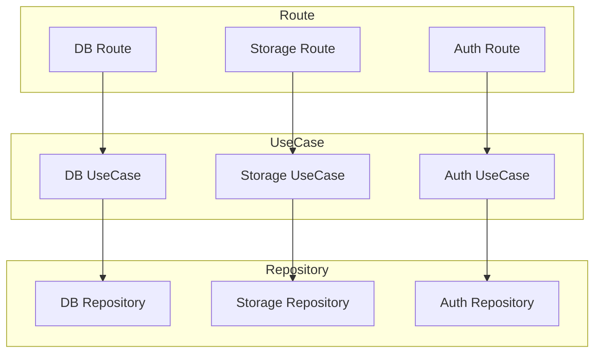

## 오늘의 기록

- DevBox
  - [devbox-light-server (10). UseCase를 동작 단위로 분리하기]()

## DevBox

하나의 타입에 묶여있던 유즈케이스들을 동작 단위로 나눴다. 이건 Express 프로젝트긴 하지만, iOS 프로젝트를 할 때 유즈케이스들이 각각 타입으로 만드는 이유도 이제야 이해했다.

일단 처음에 유즈케이스를 하나의 타입으로 묶은 이유는 크게 두가지다. 첫 번째로 BaaS 스타일의 Mock 서버를 의도했기 때문에 DB, Storage, Auth와 같은 동작이 각 계층마다 존재한다고 생각했고, 두 번째로는 모든 계층이 1:1 대응한다고 생각했다.

즉, DB 유즈케이스는 DB 레포지토리만 의존하고, DB 라우트는 DB 유즈케이스를 호출하는 방향을 생각하고 있었다:



문제를 처음 감지한건 Auth 유즈케이스에서 DB 레포지토리가 필요했을 때이다. 마찬가지로 나중에 DB 접근 제어를 추가하면, 인증 정책에 따라 DB 유즈케이스가 Auth 서비스를 사용하게 될 수도 있다.

이름 때문에 착시가 일어났고, 이번 기회에 묶여있는 유즈케이스들을 풀어줬고, 대신 디렉토리 수준으로만 간단하게 묶었다.

## TypeScript top-level function

이번 유즈케이스는 클래스를 없애고, 모듈 안에서 함수와 타입을 바로 export하는 형태로 바꿨다:

```ts
export type LogoutUseCase = (token: string) => Promise<void>;

export function createLogoutUseCase({ tokenStore }: Dependencies): LogoutUseCase {
  return async (token) => {
    await tokenStore.delete(token);
  };
}
```

Swift 프로젝트에서는 주로 각 유즈케이스를 스트럭처 형태로 작성하는데, DevBox에서는 함수로 작성했다.

단순 동작만 하면 되는 유즈케이스라서, 인스턴스가 따로 가지고 있어야 할 상태나 여러 공개 메소드가 필요하지 않기도 하다. 오늘 한 작업을 보면 이 유즈케이스도 방금 전까지 클래스에 묶여 있던 하나의 메소드였다.

Swift와 TypeScript의 파일 경계가 다른 것도 크다. Swift는 기본 접근 수준이 `internal`이라 같은 모듈 안에서는 다른 파일에 선언한 타입과 함수를 바로 사용할 수 있다. 

반면 TypeScript에서는 `import`나 `export`가 있는 파일이 하나의 모듈이 된다. 그래서 동작 하나를 함수 하나와 파일 하나로 노출하는 방식이 자연스럽다.
