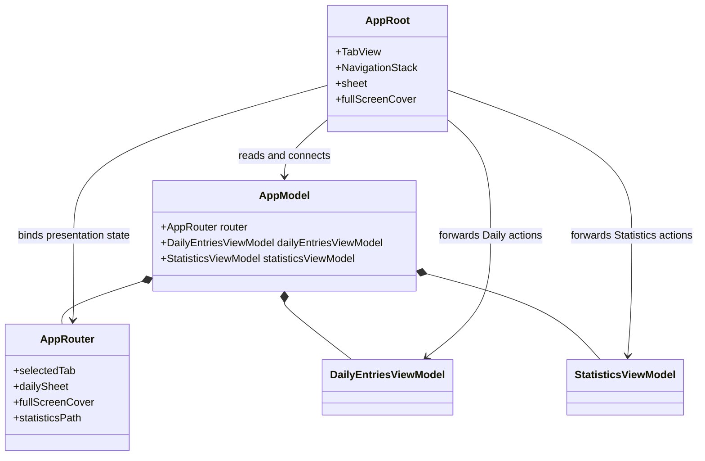

## 오늘의 기록

- Stack Day
  - 날짜 조회 취소와 중복 완료 탭 방지
  - [StackDay. App Router로 뷰 전환 상태 분리하기]()
- PS
  - [LeetCode 1520. Maximum Number of Non-Overlapping Substrings]()
  - [Programmers. 중요한 단어를 스포방지]()

## Stack Day

### 날짜 조회와 완료 탭의 비동기 처리

날짜를 빠르게 바꾸면 먼저 시작한 조회가 나중에 끝나서, 현재 선택한 날짜의 엔트리를 이전 날짜의 결과로 덮어쓸 수 있다. 새 날짜를 선택할 때 이전 조회 태스크를 취소하고, 조회가 끝난 뒤에도 취소 여부를 확인한 후 결과를 반영하도록 했다.

완료 버튼을 연속으로 누르는 경우도 막았다. `Completion` 변경 작업이 진행 중이면 `isLoading`을 확인해 같은 작업이 다시 시작되지 않도록 했다. 지연되는 레포지토리로 조회 결과의 순서가 바뀌는 경우와 완료 버튼을 중복으로 누르는 경우를 테스트했다.

### 루트 정리

`RootTabViewModel`이 탭 선택, feature 뷰 모델, 상세 화면 전환 상태를 함께 들고 있어서 화면 전환 책임이 여러 뷰와 뷰 모델에 흩어져 있었다.

Daily와 Statistics의 목록 뷰는 각자 상세 화면을 열기 위한 상태와 로직을 가지고 있었고, `RootTabViewModel`은 두 뷰 모델과 탭 선택까지 보관했다. 

여기에 `AddHabitView`는 cover, Daily 상세는 sheet, Statistics 상세는 navigation path로 열려서 같은 화면 전환 문제를 서로 다른 위치에서 처리하고 있었다.

이 상태에서는 상세 화면 하나에 필요한 상태나 동작이 늘어날 때마다 목록 뷰 모델, 루트 탭 뷰 모델, 뷰 중 어디를 고쳐야 하는지 찾아야 했다. 

#### App Router 도입

`AppRouter`에 탭, sheet, cover, navigation path를 모으고, feature 뷰는 전환 요청만 전달하도록 바꿨다. 

당시 구조는 아래처럼 `AppModel`이 앱에서 오래 살아야 하는 객체를 보관하고, `AppRoot`가 이를 SwiftUI 컨테이너와 연결하는 형태였다.

뷰 모델과 유즈케이스는 데이터를 바꾸는 일에 집중하고, 어떤 화면을 보일지는 Router 상태로 읽을 수 있게 됐다.

`AppRouter`의 route에는 `Habit` 전체가 아니라 `Habit.ID`만 넣었다. route가 표현해야 하는 것은 어떤 상세 화면을 보여줄지이고, 이름·통계·완료 상태처럼 바뀔 수 있는 데이터는 뷰 모델이 필요할 때 다시 읽는다.

또한 `presentAddHabit()`, `presentHabitDetail(habitID:)`, `showHabitStatistics(habitID:)`처럼 전환 의도를 이름 있는 메소드로 만들었다. 

feature 뷰는 사용자의 요청만 클로저로 전달하고, `AppRoot`는 필요한 뷰 모델 작업이 성공한 뒤 Router 상태를 바꾼다. 덕분에 Daily와 Statistics가 서로의 sheet나 navigation path를 알 필요가 없어졌고, Router의 상태 전환도 별도로 테스트할 수 있게 됐다.

### 남은 의문

`AppRouter`는 화면을 직접 만들거나 뷰 모델을 소유하지 않고, `selectedTab`, `sheet`, `cover`, `path`처럼 SwiftUI 표시 API에 연결할 상태만 바꾼다.

다만 Daily의 sheet와 Statistics의 navigation path까지 앱 전역 Router가 보관하고, 상세 뷰와 뷰 모델 조립은 `AppRoot`에 남아있다.

feature 안에서만 의미가 있는 전환 상태와 상세 뷰 모델의 생명주기는 feature별 Coordinator가 맡고, 앱 전역 Router에는 탭처럼 정말 전역인 상태만 남기는 편이 더 자연스러울 것 같다.

SniffMEET의 `AppRouter`는 성격이 조금 다르다. `UIWindow`의 root view controller를 바꾸고, `TabBarModuleBuilder`나 각 화면 Router를 호출해 뷰 컨트롤러를 조립하고, 세션 복구와 푸시 알림에 따른 흐름도 처리한다. 

반면 Stack Day의 SwiftUI에서는 화면이 Router의 상태를 관찰해 선언적으로 바뀐다. 그래서 객체 조립과 feature 내부 화면 상태를 Router에 계속 넣기보다, `AppRoot`, 팩토리, Coordinator처럼 생명주기 단위로 객체를 좀 나눠야 할 것 같다.

## PS

### LeetCode 1520

선택한 서브스트링에 포함된 캐릭터는 원본의 모든 등장 위치를 포함해야 하고, 겹치지 않는 서브스트링을 최대한 많이 골라야 한다. 각 캐릭터의 첫 등장 위치에서 시작해 필요한 범위를 확장하고, 유효한 최소 구간들을 끝 위치 순으로 그리디하게 선택했다.

끝이 빠른 구간부터 고르면 이후에 선택할 수 있는 공간을 더 많이 남길 수 있다.

### Programmers: 중요한 단어를 스포방지

스포일러 구간이 순서대로 공개되고, 동시에 공개된 단어는 왼쪽부터 중복 여부를 판단해야 한다. 단어의 완전 공개 시점과 시작 위치를 구해 정렬하고, 이미 등장한 단어는 집합으로 관리했다.

단어가 여러 스포일러 구간에 걸쳐 있다면 마지막 구간이 공개되어야 단어 전체를 볼 수 있다.
