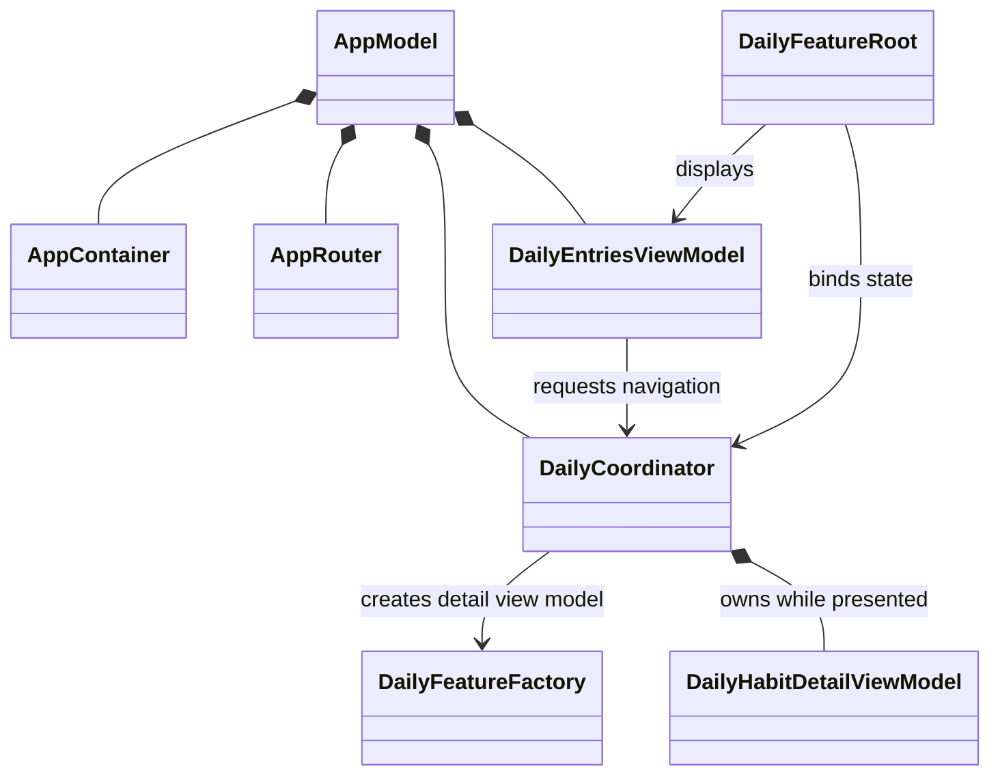

## 오늘의 기록

- Stack Day
  - [StackDay. AppRoot에 몰린 상세 뷰 조립 나누기]()
- PS
  - [LeetCode 1658. Minimum Operations to Reduce X to Zero]()
  - [Programmers. 바이러스 파이프]()

## Stack Day

### AppRouter가 맡던 역할을 Coordinator로 나누기

`AppRouter`를 도입한 뒤에도 `AppRoot`에는 feature별 상세 뷰와 뷰 모델을 조립하는 코드가 남아 있었다. 상세 화면이 늘어날수록 앱 루트가 Daily와 Statistics의 구현 세부사항을 더 많이 알게 되는 구조였다.

공유 기반 의존성은 `AppContainer`에 남기고, feature별 유즈케이스와 뷰 모델은 Factory가 조립하도록 나눴다.

상세 뷰 모델의 생성·생명주기와 feature 내부 전환 상태는 Coordinator가 맡고, `FeatureRoot`는 이를 SwiftUI 컨테이너에 연결한다. 무엇을 만들고 무엇을 소유하는지 분리하니 `AppRoot`에는 앱 전역 탭 상태만 남길 수 있다.

## PS

### LeetCode 1658

처음에는 양끝에서 무엇을 얼마나 제거할지 조합해야 하나 생각했다. 그런데 양끝을 제거하고 남는 원소는 항상 하나의 연속 부분 배열이다. 그래서 제거할 합 `x`를 직접 만들기보다, 전체 합에서 `x`를 뺀 값을 만드는 가장 긴 구간을 찾는 문제로 뒤집었다.

모든 원소가 양수라서 구간을 넓히면 합이 커지고, 줄이면 작아진다. 이 단조성 덕분에 가능한 모든 구간을 확인하지 않고 투 포인터로 목표 합을 찾을 수 있었다.

### Programmers: 바이러스 파이프

파이프는 세 종류이고 최대 열 번 열 수 있으며 같은 종류를 연속으로 고를 수 없다. 가능한 순서가 작으므로 DFS로 순서를 탐색하고, 각 선택에서 감염이 퍼지는 과정은 BFS로 계산했다.
