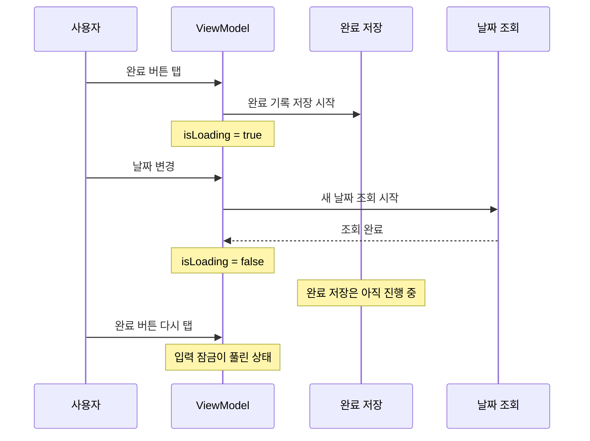

## 오늘의 기록

- Stack Day
  - `DailyEntriesView` 리스트 비동기 문제 해결
- PS
  - [LeetCode 1614. Maximum Nesting Depth of the Parentheses]()
  - [Programmers. 게임 맵 최단거리]()

## Stack Day

### 조회와 변경 작업의 상태 분리

[9월 18일에는 날짜를 빠르게 변경하면 이전 조회를 취소하고, 취소된 결과가 나중에 반영되지 않도록 처리했다.]() 작업 중에 완료 버튼을 다시 눌러 중복 요청이 실행되는 것도 막았다.

그런데 날짜 조회와 완료 상태 변경이 하나의 `isLoading`을 공유하고 있는게 맞는지 의심이 좀 들었다. 예를 들어서, 완료 기록을 저장하는 동안 날짜 조회가 시작되고 먼저 끝나면, 저장은 아직 진행 중인데 조회 쪽에서 `isLoading`을 `false`로 바꿔 입력 잠금이 풀릴 수 있다.

그래서 조회 상태는 `isEntriesLoading`, 변경 상태는 `isPerformingMutation`으로 나눴다. 두 작업 중 하나라도 진행 중이면 `isEntryInteractionLocked`가 `true`가 되고, 목록과 Habit 추가 버튼을 비활성화하며 상세 화면 진입도 막는다.

## PS

### LeetCode 1614

괄호 깊이는 문자열을 한 번 훑으며 여는 괄호와 닫는 괄호에 맞춰 추적할 수 있다. 최대 깊이만 필요하므로 스택 전체를 보관하지 않아도 된다.

### Programmers: 게임 맵 최단거리

게임 맵은 모든 이동 비용이 같은 격자 최단 거리 문제로 보았다. 처음 도착하는 경로가 최단 경로가 되는 BFS를 선택했고, 방문할 때 거리를 함께 기록하면 별도의 경로 복원이 필요 없다.
